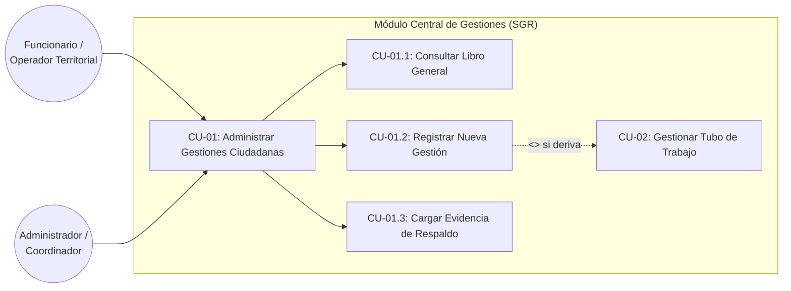
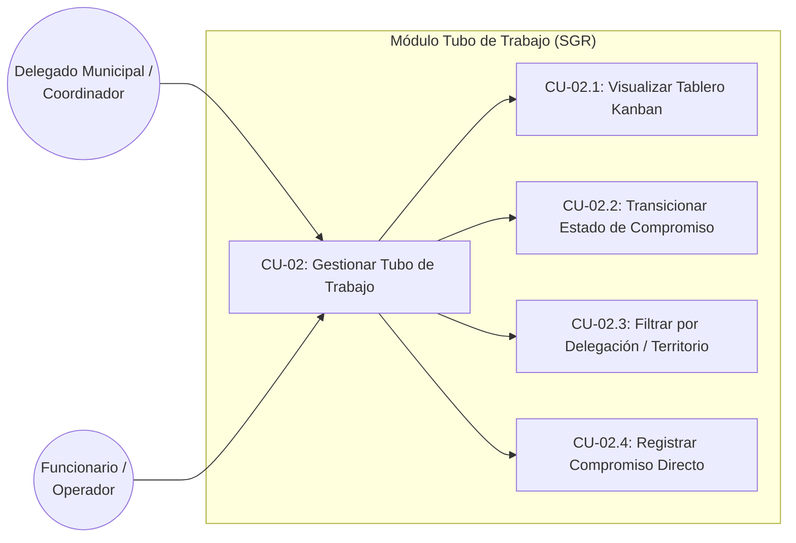

# 📐 ESPECIFICACIÓN DE WIREFRAMES Y CADENA DE TRAZABILIDAD
## SISTEMA DE GESTIÓN DE RESULTADOS (SGR) — ILUSTRE MUNICIPALIDAD DE LA SERENA
### Asignatura: Ingeniería de Software (TI2043) — Evaluación Sumativa N° 2 (25%)

---

## 📌 Introducción y Propósito

El presente documento formaliza la **Cadena de Trazabilidad Integral** y el diseño de los **Wireframes Front-End** exigidos en la *Guía de Formulación de Proyecto (Etapa 2)* de la asignatura de **Ingeniería de Software (TI2043)**.

Para asegurar un estándar de calidad riguroso y cumplir con la rúbrica de evaluación, se implementa la cadena estricta demandada por la pauta:

$$\mathbf{Requerimiento\ Funcional\ (RF)} \longrightarrow \mathbf{Épica} \longrightarrow \mathbf{Caso\ de\ Uso\ Alto\ Nivel} \longrightarrow \mathbf{Caso\ de\ Uso\ Específico} \longrightarrow \mathbf{WireFrame\ (Front\text{-}End)}$$

Se desarrollan los dos flujos operativos troncales del sistema:
1. **Flujo A:** *Formulario de Registro Unificado de Gestiones con Derivación al Tubo de Trabajo*.
2. **Flujo B:** *Tablero Kanban del Tubo de Trabajo (Agenda Colectiva y Seguimiento Intersectorial)*.

---

## 🔗 FLUJO A: REGISTRO UNIFICADO DE GESTIÓN Y DERIVACIÓN AL TUBO

### 1.1 Requerimiento Funcional (RF)

* **Código:** `RF-016`
* **Nombre:** Registro Centralizado de Gestiones Comunales y Derivación Opcional al Tubo de Trabajo.
* **Descripción:** El sistema debe permitir a los funcionarios u operadores registrar en una única interfaz cualquier solicitud ciudadana, caso social o actividad territorial, capturando los datos del vecino (nombre, RUT, teléfono, dirección y territorio), clasificándola mediante un catálogo temático en dos niveles (Tipo y SubAtención), y ofreciendo la opción de derivar inmediatamente el requerimiento al método de *Tubo de Trabajo* mediante la asignación de fecha comprometida, área municipal de apoyo y territorio específico.
* **Criterios de Aceptación:**
  * Debe generar automáticamente un código de gestión único correlativo (`GES-XXXXX` para atenciones estándar o `SOC-XXXXX` para casos sociales).
  * Si se activa el selector de Tubo de Trabajo (`ingreso_tubo = SI`), debe crearse en la misma transacción un compromiso enlazado con código `TUB-XXXXX` visible en el Tablero Kanban.
  * Debe generar un código de evidencia fotográfica preliminar `EVI-YYYYMMDD-XXXX`.

---

### 1.2 Épica

* **Código:** `EP-01`
* **Nombre de la Épica:** Gestión Centralizada de Demandas Ciudadanas y Derivación Intersectorial.
* **Declaración de Valor:**
  > *"Como funcionario u operador municipal de delegación territorial, quiero disponer de una ventanilla única para ingresar solicitudes vecinales, requerimientos de terreno y fichas sociales, para que toda la carga comunal quede consolidada en un solo repositorio y pueda derivarse formalmente a coordinación interdepartamental cuando exceda la capacidad de resolución inmediata."*
* **Historias de Usuario (HU) Asociadas:**
  * `HU-01.1:` Registro de datos del solicitante y sector territorial.
  * `HU-01.2:` Clasificación temática en cascada mediante catálogo municipal.
  * `HU-01.3:` Activación condicional de ficha especializada de Gestor Social (flujo multi-etapa).
  * `HU-01.4:` Derivación automática al Tubo de Trabajo con generación de folio `TUB-XXXXX`.

---

### 1.3 Caso de Uso de Alto Nivel

* **Identificador:** `CU-01`
* **Nombre:** Administrar Gestiones Ciudadanas y Territoriales.
* **Actores Principales:** Funcionario / Operador Territorial, Gestor Social, Delegado Municipal.
* **Diagrama de Caso de Uso de Alto Nivel (Mermaid):**



---

### 1.4 Caso de Uso Específico (Cuadro de Detalle Normalizado)

| Atributo | Detalle de Especificación |
|---|---|
| **Identificador** | `CU-01.2` |
| **Nombre** | Registrar Nueva Gestión con Activación de Tubo de Trabajo |
| **Actor(es)** | Funcionario / Operador Territorial (iniciador), Delegado Municipal (iniciador), Administrador (iniciador). |
| **Propósito** | Capturar en el repositorio institucional una solicitud comunal, asignar folios oficiales y, si amerita seguimiento interdepartamental, encolarla en el método Kanban del Tubo de Trabajo. |
| **Precondiciones** | 1. El usuario debe estar autenticado en la plataforma.<br>2. Debe tener asignada una delegación activa en sesión.<br>3. Los catálogos de Tipos, SubAtenciones y Funcionarios deben estar activos. |
| **Flujo Principal (Happy Path)** | 1. El actor ingresa a la opción *Gestiones $\rightarrow$ Nueva Gestión* (`/actividades/nueva/`).<br>2. El sistema presenta el formulario unificado con fecha actual preseleccionada, funcionario logueado como responsable y sugerencia de código correlativo `GES-XXXXX`.<br>3. El actor ingresa los datos del vecino (nombre, RUT, teléfono, correo y dirección).<br>4. El actor selecciona el *Tipo de Atención*; el sistema carga asíncronamente (AJAX) las *SubAtenciones* dependientes.<br>5. El actor ingresa la *Solicitud / Problema* y la *Acción Realizada / Propuesta*.<br>6. El actor activa el switch: *"¿Derivar al Tubo de Trabajo? = SI"*.<br>7. El sistema despliega dinámicamente la sección del Tubo solicitando: Fecha Comprometida, Área de Apoyo y Territorio/Sector.<br>8. El actor presiona el botón *Guardar Gestión y Generar Folio Oficial*.<br>9. El sistema valida los datos obligatorios, inicia una transacción en MySQL, inserta el registro en la tabla `actividades`, inserta el compromiso en `compromisos_tubo` vinculando `id_actividad`, genera los folios `GES-XXXXX`, `TUB-XXXXX` y `EVI-YYYYMMDD-XXXX`.<br>10. El sistema redirige al *Libro General de Gestiones* mostrando mensaje de éxito SweetAlert2. |
| **Flujos Alternativos / Excepción** | **3a. Caso Social Especializado:** Si el actor activa *"¿Es Gestión Social?"*, el sistema conmuta el prefijo a `SOC-XXXXX` y despliega la ficha multi-etapa (Visitas, FIBE, Beneficios).<br>**9a. Campos obligatorios incompletos:** El sistema bloquea el guardado, resalta los inputs vacíos en rojo y muestra alerta de advertencia sin recargar la página.<br>**9b. Error de conexión con BD:** Se revierte la transacción (rollback) y se notifica al usuario. |
| **Postcondiciones** | La gestión queda visible en la pestaña correspondiente del Libro de Gestiones y la tarjeta aparece inmediatamente en la columna *Ingresados / Pendientes* del Tablero Kanban. |

---

### 1.5 Wireframe Front-End: Formulario Unificado de Gestiones

A continuación se presenta el **esquema estructural / blueprint de baja y mediana fidelidad** del Wireframe correspondiente a `CU-01.2`:

```
┌──────────────────────────────────────────────────────────────────────────────────────────────────────────────┐
│  MUNICIPALIDAD DE LA SERENA — SGR                               👤 Juan Pérez (Delegado Las Compañías) [Salir]│
├──────────────────────────────────────────────────────────────────────────────────────────────────────────────┤
│  [ Inicio ]   [ Gestiones ▼ ]   [ Tubo de Trabajo ]   [ Mantenedores ▼ ]   [ Organización ]   [ Resultados ]  │
├──────────────────────────────────────────────────────────────────────────────────────────────────────────────┤
│                                                                                                              │
│  MÓDULO CENTRAL DE GESTIONES                                                                                 │
│  <h1>Formulario Unificado de Registro de Gestión</h1>                                                         │
│  <small>Registro oficial para demandas ciudadanas, atenciones de mesón, operativos y casos sociales</small> │
│                                                                                                              │
│  ┌─ [1] ENCABEZADO DE CONTROL INSTITUCIONAL ──────────────────────────────────────────────────────────────┐ │
│  │  Delegación Activa: [ Las Compañías Alta (DEL-01) ▼ ]     Fecha Registro: [ 22/10/2026 ]                │ │
│  │  Código Sugerido:   [ GES-00028 ]                         Código Evidencia: [ EVI-20261022-0028 ]       │ │
│  └────────────────────────────────────────────────────────────────────────────────────────────────────────┘ │
│                                                                                                              │
│  ┌─ [2] DATOS DEL SOLICITANTE / VECINO ────────────────────────────────────────────────────────────────────┐ │
│  │  Nombre y Apellidos (*): [ Roberto Carlos Valenzuela Araya                          ]                   │ │
│  │  RUT: [ 12.345.678-9      ]   Teléfono: [ +56 9 8765 4321   ]   Correo: [ rvalenzuela@vecino.cl       ] │ │
│  │  Dirección / Pasaje:     [ Pasaje Las Rosas #450, Villa El Brillador              ]                   │ │
│  │  Territorio / Sector:    [ Las Compañías Alta - Sector El Salitre                 ]                   │ │
│  └────────────────────────────────────────────────────────────────────────────────────────────────────────┘ │
│                                                                                                              │
│  ┌─ [3] CLASIFICACIÓN TEMÁTICA Y RESPONSABLE ──────────────────────────────────────────────────────────────┐ │
│  │  Tipo de Atención (*):        [ Infraestructura y Espacios Públicos (TIP-02)     ▼ ]                    │ │
│  │  Sub Atención en Cascada (*): [ Bacheo y Pavimentación Participativa (SUB-04)    ▼ ]  <-- (Carga AJAX)  │ │
│  │  Funcionario Responsable (*): [ Acuaman (Encargado de Operaciones)                ▼ ]                   │ │
│  │  Ítem Evaluación SGR (*):     [ GESTIÓN TERRITORIAL Y OPERATIVOS                 ▼ ]                   │ │
│  └────────────────────────────────────────────────────────────────────────────────────────────────────────┘ │
│                                                                                                              │
│  ┌─ [4] REQUERIMIENTO Y RESPUESTA MUNICIPAL ───────────────────────────────────────────────────────────────┐ │
│  │  Detalle del Problema / Solicitud (*):                                                                  │ │
│  │  [ Vecinos reportan socavón pronunciado en calzada tras rotura de matriz. Peligro inminente.          ] │ │
│  │  [ Requiere intervención de cuadrilla de obras y señalización provisoria.                             ] │ │
│  │  Acción Realizada / Respuesta Inmediata (*):                                                            │ │
│  │  [ Inspección visual en terreno coordinada con cuadrilla y presidente de la junta de vecinos.         ] │ │
│  │  Estado de la Gestión: (o) Pendiente   ( ) En Proceso   ( ) Realizado                                   │ │
│  └────────────────────────────────────────────────────────────────────────────────────────────────────────┘ │
│                                                                                                              │
│  ┌─ [5] SECCIÓN CONDICIONAL: TUBO DE TRABAJO (SEGUIMIENTO INTERSECTORIAL) ─────────────────────────────────┐ │
│  │  [X] ¿MANDAR AL MÉTODO DE TUBO DE TRABAJO? (Requiere coordinación entre áreas)                         │ │
│  │  ┌───────────────────────────────────────────────────────────────────────────────────────────────────┐  │ │
│  │  │  Fecha Límite Comprometida (*): [ 15/11/2026 ]    Área de Apoyo Requerida (*): [ Obras y Tránsito]│  │ │
│  │  │  Territorio Específico del Tubo: [ Sector El Salitre - Eje Central                               ]│  │ │
│  │  │  ℹ️ Al guardar, se creará una tarjeta TUB-XXXXX visible inmediatamente en el Tablero Kanban.      │  │ │
│  │  └───────────────────────────────────────────────────────────────────────────────────────────────────┘  │ │
│  └────────────────────────────────────────────────────────────────────────────────────────────────────────┘ │
│                                                                                                              │
│  ┌─ [6] SECCIÓN CONDICIONAL: GESTOR SOCIAL ────────────────────────────────────────────────────────────────┐ │
│  │  [ ] ¿ES CASO SOCIAL ESPECIALIZADO? (Activar para flujo multi-etapa de visitas, informes y ayudas)      │ │
│  └────────────────────────────────────────────────────────────────────────────────────────────────────────┘ │
│                                                                                                              │
│  [ Cancelar / Volver ]                                   [ 💾 GUARDAR GESTIÓN Y GENERAR FOLIO OFICIAL ]      │
└──────────────────────────────────────────────────────────────────────────────────────────────────────────────┘
```

#### Diccionario de Elementos del Wireframe:
1. `[1] Encabezado:` Despliega datos de contexto inmutables. Muestra la delegación fijada en sesión y los códigos sugeridos.
2. `[2] Solicitante:` Campos de formulario para contacto del vecino con validación de formato RUT chileno y teléfono.
3. `[3] Clasificación:` Dropdowns dependientes; al cambiar el *Tipo de Atención*, se disparan las opciones de *SubAtención* vía endpoint `/api/subatenciones/`.
4. `[4] Requerimiento:` Áreas de texto enriquecidas con límite de caracteres para solicitud y acción.
5. `[5] Bloque Tubo de Trabajo:` Acordeón reactivo controlado por JavaScript. Permanece oculto si el switch está en `NO` y se expande fluidamente si se selecciona `SÍ`.
6. `[6] Bloque Gestor Social:` Switch booleano que, al activarse, sustituye el prefijo por `SOC-` y despliega campos de visita en terreno, fecha informe social y entrega de beneficios.

---

## 🔗 FLUJO B: SEGUIMIENTO INTERSECTORIAL EN TABLERO KANBAN (TUBO DE TRABAJO)

### 2.1 Requerimiento Funcional (RF)

* **Código:** `RF-017`
* **Nombre:** Tablero Kanban Intersectorial del Método Tubo de Trabajo.
* **Descripción:** El sistema debe proporcionar una vista de Tablero Kanban que organice visualmente todos los compromisos comunitarios derivados al Tubo de Trabajo en 4 columnas secuenciales (*Ingresados*, *Pendientes*, *En Proceso*, *Realizados*). Cada tarjeta debe exhibir el código del Tubo (`TUB-XXXXX`), la insignia interactiva de la gestión de origen (`[GES-XXXXX]` o `[SOC-XXXXX]`), el solicitante, el territorio y el área de apoyo, permitiendo la transición directa de estados.
* **Criterios de Aceptación:**
  * Al hacer clic en el botón de avance de una tarjeta (*"A Proceso"*, *"Realizar"*), el estado en base de datos debe actualizarse inmediatamente.
  * Si un compromiso pasa a `REALIZADO`, la gestión unificada vinculada debe actualizar su estado correspondiente.
  * Al presionar la insignia del código de gestión de origen, debe redirigir a la Ficha de Gestión (`/actividades/actividad/<id>/`).

---

### 2.2 Épica

* **Código:** `EP-02`
* **Nombre de la Épica:** Trazabilidad, Coordinación y Control Operativo del Tubo de Trabajo.
* **Declaración de Valor:**
  > *"Como Delegado Municipal o Coordinador Comunal, quiero visualizar la carga de compromisos de mi territorio organizada en un tablero Kanban ágil, para identificar rápidamente cuellos de botella en áreas de apoyo, priorizar visitas y asegurar el cumplimiento de las fechas pactadas con las juntas de vecinos."*
* **Historias de Usuario (HU) Asociadas:**
  * `HU-02.1:` Visualización de tarjetas clasificadas por columna de estado operativo.
  * `HU-02.2:` Transición de estado con un solo clic entre etapas del ciclo de vida.
  * `HU-02.3:` Trazabilidad visual hacia la gestión madre originaria.

---

### 2.3 Caso de Uso de Alto Nivel

* **Identificador:** `CU-02`
* **Nombre:** Gestionar Tubo de Trabajo Municipal.
* **Actores Principales:** Delegado Municipal, Coordinador Comunal, Funcionario Responsable.
* **Diagrama de Caso de Uso de Alto Nivel (Mermaid):**



---

### 2.4 Caso de Uso Específico (Cuadro de Detalle Normalizado)

| Atributo | Detalle de Especificación |
|---|---|
| **Identificador** | `CU-02.1` |
| **Nombre** | Visualizar y Transicionar Estados en Tablero Kanban |
| **Actor(es)** | Delegado Municipal (iniciador), Coordinador Comunal (iniciador), Funcionario Responsable. |
| **Propósito** | Monitorear el flujo de compromisos del territorio y avanzar las tareas de etapa según el progreso técnico reportado por las áreas de apoyo. |
| **Precondiciones** | 1. Usuario autenticado con rol autorizado.<br>2. Existencia de compromisos registrados en la tabla `compromisos_tubo`. |
| **Flujo Principal (Happy Path)** | 1. El actor selecciona *Tubo de Trabajo* en el menú principal (`/agenda/resumen/`).<br>2. El sistema consulta la base de datos MySQL filtrando por la delegación activa y organiza los registros en 4 listas según su campo `estado`.<br>3. El sistema renderiza el tablero con 4 columnas, mostrando en el encabezado de cada una el conteo total de tarjetas.<br>4. Cada tarjeta expone: Código `TUB-XXXXX`, badge `[GES/SOC]`, actividad resumida, solicitante, área de apoyo, funcionario y botones de acción.<br>5. El actor localiza la tarjeta `TUB-00023` en la columna *En Proceso* y presiona el botón *✓ Realizar*.<br>6. El sistema envía una petición GET a `/agenda/cambiar-estado/<id>/REALIZADO/`.<br>7. El controlador actualiza el estado en `Compromiso` a `REALIZADO` y, si tiene una gestión vinculada (`id_actividad`), actualiza la `Actividad` a `Realizado`.<br>8. El sistema recarga el tablero mostrando la tarjeta reubicada en la columna *4. Realizados* con color verde de éxito. |
| **Flujos Alternativos / Excepción** | **4a. Compromiso sin gestión origen:** Si el compromiso fue ingresado directamente sin pasar por gestión, la tarjeta omite el badge azul y opera de forma autónoma sin error.<br>**7a. Fallo de autorización:** Si un operador intenta modificar un compromiso fuera de su delegación, el sistema emite HTTP 403 Forbidden. |
| **Postcondiciones** | El compromiso queda registrado como cumplido, sumando para el indicador de avance en el módulo de Resultados y Metas SGR. |

---

### 2.5 Wireframe Front-End: Tablero Kanban del Tubo de Trabajo

Esquema estructural / blueprint de baja y mediana fidelidad del Tablero Kanban (`CU-02.1`):

```
┌──────────────────────────────────────────────────────────────────────────────────────────────────────────────┐
│  MUNICIPALIDAD DE LA SERENA — SGR                               👤 Carlos Delegado [Las Compañías]   [Salir]│
├──────────────────────────────────────────────────────────────────────────────────────────────────────────────┤
│  [ Inicio ]   [ Gestiones ▼ ]   [ Tubo de Trabajo ]   [ Mantenedores ▼ ]   [ Organización ]   [ Resultados ]  │
├──────────────────────────────────────────────────────────────────────────────────────────────────────────────┤
│                                                                                                              │
│  MÉTODO DE SEGUIMIENTO INTERSECTORIAL                                                                        │
│  <h1>Tablero Kanban — Tubo de Trabajo</h1>                                       [ + Nuevo Compromiso ]      │
│  <small>Monitoreo de compromisos derivados de gestiones ciudadanas coordinadas entre unidades</small>        │
│                                                                                                              │
│  ┌────────────────────────┬────────────────────────┬────────────────────────┬─────────────────────────────┐  │
│  │ 1. INGRESADOS      (2) │ 2. PENDIENTES      (3) │ 3. EN PROCESO      (4) │ 4. REALIZADOS           (8) │  │
│  ├────────────────────────┼────────────────────────┼────────────────────────┼─────────────────────────────┤  │
│  │ ┌────────────────────┐ │ ┌────────────────────┐ │ ┌────────────────────┐ │ ┌─────────────────────────┐ │  │
│  │ │ TUB-00028          │ │ │ TUB-00026          │ │ │ TUB-00023          │ │ │ TUB-00019               │ │  │
│  │ │ [GES-00028] (Link) │ │ │ [GES-00025] (Link) │ │ │ [SOC-00027] (Link) │ │ │ [SOC-00023] (Link)      │ │  │
│  │ ├────────────────────┤ │ ├────────────────────┤ │ ├────────────────────┤ │ ├─────────────────────────┤ │  │
│  │ │ Socavón calzada en │ │ │ Luminarias pasaje  │ │ │ Entrega canasta y  │ │ │ Techumbre emergencia    │ │  │
│  │ │ Pasaje Las Rosas   │ │ │ Los Lirios #45     │ │ │ subsidio alimentos │ │ │ sector rural El Romero  │ │  │
│  │ │                    │ │ │                    │ │ │                    │ │ │                         │ │  │
│  │ │ 👤 R. Valenzuela   │ │ │ 👤 M. Henríquez    │ │ │ 👤 B. Ossa M.      │ │ │ 👤 G. Cortés            │ │  │
│  │ │ 📍 El Salitre      │ │ │ 📍 Las Rosas       │ │ │ 📍 El Romero       │ │ │ 📍 Minas Brillador      │ │  │
│  │ │ 🛠️ Obras y Tránsito│ │ │ 🛠️ Alumbrado Públ. │ │ │ 🛠️ DIDECO Social   │ │ │ 🛠️ Operaciones Emerg.   │ │  │
│  │ ├────────────────────┤ │ ├────────────────────┤ │ ├────────────────────┤ │ ├─────────────────────────┤ │  │
│  │ │ 👤 Acuaman         │ │ │ 👤 Pantera Negra   │ │ │ 👤 Acuaman         │ │ │ 👤 Flash                │ │  │
│  │ │ [Ver] [A Pendiente]│ │ │ [Ver] [A Proceso →]│ │ │ [Ver] [✓ Realizar] │ │ │ [Ver Detalle]  (Cerrada)│ │  │
│  │ └────────────────────┘ │ └────────────────────┘ │ └────────────────────┘ │ └─────────────────────────┘ │  │
│  │                        │                        │                        │                             │  │
│  │ ┌────────────────────┐ │ ┌────────────────────┐ │ ┌────────────────────┐ │ ┌─────────────────────────┐ │  │
│  │ │ TUB-00027          │ │ │ TUB-00024          │ │ │ TUB-00021          │ │ │ TUB-00016               │ │  │
│  │ │ (Directo sin GES)  │ │ │ [GES-00021] (Link) │ │ │ [GES-00019] (Link) │ │ │ [GES-00014] (Link)      │ │  │
│  │ ├────────────────────┤ │ ├────────────────────┤ │ ├────────────────────┤ │ ├─────────────────────────┤ │  │
│  │ │ Poda de eucaliptus │ │ │ Señalética Pare    │ │ │ Reductor velocidad │ │ │ Limpieza microbasural   │ │  │
│  │ │ JJVV Terrazas      │ │ │ Av. Islón / Brasil │ │ │ Av. Islón #120     │ │ │ Quebrada San Pedro      │ │  │
│  │ │                    │ │ │                    │ │ │                    │ │ │                         │ │  │
│  │ │ 👤 Carlos Muñoz    │ │ │ 👤 Roberto Soto    │ │ │ 👤 JJVV Brillador  │ │ │ 👤 Vecinos La Pampa     │ │  │
│  │ │ 📍 Terrazas        │ │ │ 📍 Casco Histórico │ │ │ 📍 Las Compañías   │ │ │ 📍 Sector Rural         │ │  │
│  │ │ 🛠️ Parques y Jardín│ │ │ 🛠️ Tránsito Vial   │ │ │ 🛠️ Obras Viales    │ │ │ 🛠️ Aseo y Ornato        │ │  │
│  │ ├────────────────────┤ │ ├────────────────────┤ │ ├────────────────────┤ │ ├─────────────────────────┤ │  │
│  │ │ 👤 Capitán América │ │ │ 👤 Hulk            │ │ │ 👤 Acuaman         │ │ │ 👤 Thor                 │ │  │
│  │ │ [Ver] [A Pendiente]│ │ │ [Ver] [A Proceso →]│ │ │ [Ver] [✓ Realizar] │ │ │ [Ver Detalle]  (Cerrada)│ │  │
│  │ └────────────────────┘ │ └────────────────────┘ │ └────────────────────┘ │ └─────────────────────────┘ │  │
│  └────────────────────────┴────────────────────────┴────────────────────────┴─────────────────────────────┘  │
└──────────────────────────────────────────────────────────────────────────────────────────────────────────────┘
```

---

## 📊 Matriz Comparativa de Trazabilidad entre Requerimientos y Pantallas

| Código RF | Épica Asociada | Caso de Uso Alto Nivel | Caso de Uso Detalle | Elemento Front-End / Wireframe | URL en Producción |
|---|---|---|---|---|---|
| **RF-016** | `EP-01` (Gestión Centralizada) | `CU-01` Administrar Gestiones | `CU-01.2` Registrar con Derivación al Tubo | Formulario Unificado con switch interactivo `#seccionTubo` | [`http://3.229.11.31/actividades/nueva/`](http://3.229.11.31/actividades/nueva/) |
| **RF-017** | `EP-02` (Seguimiento Tubo) | `CU-02` Gestionar Tubo de Trabajo | `CU-02.1` Visualizar y Transicionar Estados Kanban | Tablero Kanban con 4 columnas, tarjetas interactivas y badge trazable | [`http://3.229.11.31/agenda/resumen/`](http://3.229.11.31/agenda/resumen/) |
| **RF-018** | `EP-01` (Casos Sociales) | `CU-01` Administrar Gestiones | `CU-01.3` Registrar Caso Social Multi-Etapa | Acordeón Gestor Social con 3 etapas (Diagnóstico, Terreno, Beneficio) | [`http://3.229.11.31/actividades/social/nueva/`](http://3.229.11.31/actividades/social/nueva/) |
| **RF-020** | `EP-03` (Control Evidencias) | `CU-01` Administrar Gestiones | `CU-01.4` Auditar y Validar Evidencia Fotográfica | Panel técnico con vista previa fotográfica y checklist de aprobación | [`http://3.229.11.31/actividades/evidencias/`](http://3.229.11.31/actividades/evidencias/) |

---

## 🛠️ Entregable Interactivo Complementario

Para visualizar estos wireframes en alta fidelidad y con interactividad en el navegador, se creó el archivo:
📁 **[`wireframe_interactivo_sgr.html`](file:///d:/Django/Backend/Contexto%20de%20la%20problematica/02_Modelamiento_y_Diseno/wireframe_interactivo_sgr.html)**

Contiene:
* Blueprint visual renderizado con paleta neutral de wireframing arquitectónico.
* Anotaciones numéricas desplegables con explicación técnica de cada control.
* Switches interactivos funcionales que emulan el comportamiento dinámico del JavaScript en producción.
