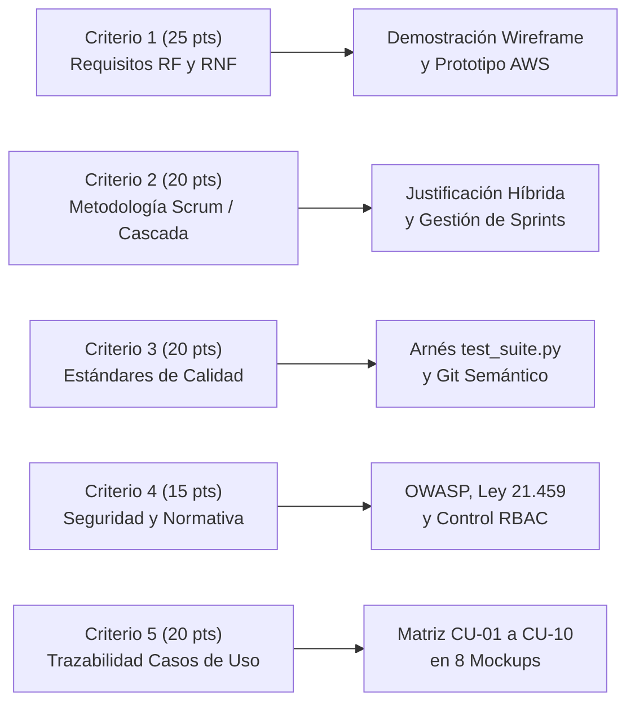

# 🛡️ GUÍA MAESTRA DE DEFENSA PRESENCIAL (10 MINUTOS)
## SISTEMA DE GESTIÓN DE RESULTADOS (SGR) — ILUSTRE MUNICIPALIDAD DE LA SERENA
### Asignatura: Ingeniería de Software (TI2043) — Evaluación Sumativa N° 3 (Ponderación 35%)
#### INACAP Sede La Serena · Área Informática, Ciberseguridad y Telecomunicaciones

---

## 📌 FICHA TÉCNICA DE LA EVALUACIÓN

| Parámetro | Detalle Institucional |
| :--- | :--- |
| **Asignatura** | Ingeniería de Software (TI2043) — Primavera 2026 |
| **Unidad 3** | Implementación, pruebas y calidad de Software |
| **Ponderación** | **35% de la nota final** |
| **Modalidad** | Grupal (3 a 4 integrantes) con evaluación individual |
| **Tiempo Límite** | **10 minutos cronometrados de demostración continua** |
| **Orden de Presentación** | Asignado al azar por el académico |
| **URL Producción AWS EC2** | [http://3.229.11.31/](http://3.229.11.31/) |
| **URL Wireframe Interactivo** | [http://3.229.11.31/wireframes/](http://3.229.11.31/wireframes/) |
| **Repositorio GitHub** | [https://github.com/iScreamyy6/Backend](https://github.com/iScreamyy6/Backend) |
| **Arnés de Pruebas Automatizadas** | `python test_suite.py` (14 secciones, 100% aprobado) |

---

## 🎯 ALINEACIÓN CON LA RÚBRICA DOCENTE (100 PUNTOS)

Para asegurar la nota máxima (Calificación 7.0 / 100 puntos), cada sección de la presentación ataca directamente un criterio de la pauta:



| Criterio de Rúbrica | Pts | Foco de la Defensa | Evidencia Concreta a Mostrar |
| :--- | :---: | :--- | :--- |
| **1. Requerimientos Funcionales y No Funcionales** | **25** | Cumplimiento del negocio municipal, velocidad de respuesta y modularidad MVT. | Prototipo funcional en AWS EC2 respondiendo en < 200 ms con Bootstrap 5 y paleta oficial. |
| **2. Aplicación Metodológica (Tradicional / Scrum)** | **20** | Justificar el modelo híbrido: Cascada para análisis y Scrum para desarrollo iterativo. | Cronograma de 3 Sprints, artefactos del Product Backlog e historias de usuario (HU). |
| **3. Estándares de Calidad y Gestión del Proyecto** | **20** | Versionamiento Git semántico, documentación y testing automatizado. | Ejecución en vivo de `test_suite.py` con 14 suites pasando limpiamente en la base de datos. |
| **4. Estándares de Seguridad en la Construcción** | **15** | Prevención de OWASP Top 10, tokens criptográficos, RBAC y Ley 21.459. | Demostración de recuperación con PIN hash, CSRF tokens y restricción por perfiles de usuario. |
| **5. Reflejo de Diagramas de Caso de Uso** | **20** | Correspondencia exacta de los 10 Casos de Uso formales en las pantallas del sistema. | Recorrido de los 8 Mockups interactivos en `/wireframes/` y su contraparte en Django. |

---

## ⏱️ CRONOGRAMA MINUTO A MINUTO (LOS 10 MINUTOS EXACTOS)

```
0:00        1:30        3:00                 5:30                 7:30           9:00       10:00
|-----------|-----------|--------------------|--------------------|--------------|----------|
 Bloque 1    Bloque 2    Bloque 3             Bloque 4             Bloque 5       Bloque 6
 Contexto    Metodología Wireframe            Prototipo Real       Arnés Pruebas  Cierre
 y Cloud     Híbrida     Casos de Uso (CU)    AWS + Seguridad      Automatizadas  y Preguntas
 (1.5 min)   (1.5 min)   (2.5 min)            (2.0 min)            (1.5 min)      (1.0 min)
```

---

## 🗣️ GUION DETALLADO Y SPEECH SUGERIDO (PASO A PASO)

### ⏱️ BLOQUE 1: APERTURA, PROBLEMÁTICA Y ARQUITECTURA CLOUD (0:00 – 1:30)
* **Objetivo:** Captar la atención del docente, contextualizar la problemática real de La Serena y fundamentar las tendencias tecnológicas cloud (SaaS/IaaS) exigidas en el aprendizaje esperado 3.1.1.
* **Qué proyectar:** Diapositiva 1 / Portada y esquema de arquitectura AWS EC2 + MySQL 8.x.

> **Speech Sugerido:**
> *"Buenos días profesor y comisión evaluadora. Hoy presentamos la culminación del Sistema de Gestión de Resultados (SGR) para la Ilustre Municipalidad de La Serena.*
> 
> *El problema central que resolvimos fue la dispersión operativa: las delegaciones municipales como Las Compañías o La Antena operaban con planillas desconectadas, duplicando solicitudes y perdiendo el seguimiento de los compromisos vecinales.*
> 
> *Para resolverlo, diseñamos una arquitectura cloud moderna bajo el paradigma **IaaS (Infraestructura como Servicio)** sobre una instancia **AWS EC2 Ubuntu 24.04**, sirviendo el backend con **Django 5.x y Python 3.14**, y persistiendo en **MySQL 8.x**. Esta infraestructura permite a la municipalidad evolucionar hacia un modelo **SaaS (Software como Servicio)** interno, donde cada delegación territorial accede de forma centralizada sin requerir servidores locales."*

---

### ⏱️ BLOQUE 2: METODOLOGÍA HÍBRIDA Y GESTIÓN DE CALIDAD (1:30 – 3:00)
* **Objetivo:** Demostrar dominio total del Criterio 2 (20 pts), justificando técnicamente por qué se usó Cascada y Scrum de manera combinada.
* **Qué proyectar:** Diapositiva con el ciclo de 3 Sprints y el gráfico de metodología híbrida.

> **Speech Sugerido:**
> *"En el criterio metodológico, adoptamos un enfoque **Híbrido de Ingeniería de Software** rigurosamente justificado:*
> 
> *1. **¿Por qué Modelo Cascada para la Etapa 1?** En el sector municipal rigen normativas de auditoría estrictas. Era imperativo levantar formalmente los 38 Requerimientos Funcionales, normalizar el Modelo Entidad-Relación en Tercera Forma Normal (3NF) y diseñar los Casos de Uso antes de escribir código. Improvisar un modelo relacional en un sistema público comprometería la integridad referencial.*
> 
> *2. **¿Por qué Scrum para las Etapas 2 y 3?** Una vez establecida la base arquitectónica, organizamos el desarrollo en **3 Sprints de 2 semanas**. Usamos historias de usuario estimadas en Story Points, revisiones al final de cada sprint y retrospectivas. Esto nos permitió entregar valor funcional continuo: en el Sprint 1 maquetamos prototipos y autenticación; en el Sprint 2 integramos los 6 mantenedores CRUD y persistencia MySQL; y en este Sprint 3 completamos los flujos de seguridad, recuperación por token seguro, tablero kanban y el despliegue en la nube."*

---

### ⏱️ BLOQUE 3: DEMOSTRACIÓN DE WIREFRAMES Y TRAZABILIDAD (3:00 – 5:30)
* **Objetivo:** Cumplir el producto obligatorio de la unidad ("presentar un mockup y/o wireframe interactivo y defender su construcción") y el Criterio 5 (20 pts de Casos de Uso).
* **Qué proyectar:** Navegador web en vivo en `http://3.229.11.31/wireframes/`.

> **Speech Sugerido:**
> *(Navegando en `/wireframes/`)*
> *"A continuación demostramos nuestro artefacto interactivo de wireframes, diseñado con la paleta cromática institucional de La Serena (`#AD0000`) y con interactividad total:*
> 
> * * **Mockup 1 (CU-01 y CU-02):** Autenticación dual (usuario o email) y recuperación de contraseña en 3 pasos con validación de PIN de 6 dígitos.*
> * * **Mockup 2 (CU-09):** Dashboard dinámico con control RBAC. Observen cómo al alternar entre Administrador, Supervisor y Operador, la interfaz adapta métricas y oculta menús restringidos.*
> * * **Mockup 3 (CU-05):** Registro Unificado de Gestiones con autocompletado de vecino por RUT vía AJAX y derivación automática al Tubo de Trabajo.*
> * * **Mockup 4 (CU-07):** Tablero Kanban del Tubo de Trabajo en 4 columnas. Las tarjetas cuentan con folios relacionales `[GES-XXXXX]` y permiten mover físicamente el compromiso hacia 'Realizado'.*
> * * **Mockup 5 (CU-06):** Ficha Social con evaluación del Registro Social de Hogares (tramos 40%, 60%, 70%) y asignación de ayudas críticas.*
> * * **Mockup 6:** Semáforo de Metas SGR con cálculo dinámico de cumplimiento (+5% de avance) y algoritmos tricolor.*
> * * **Mockup 7 (CU-03, CU-04 y CU-10):** Mantenedores CRUD con pestañas para Delegaciones, Usuarios y Roles, creación modal y simulación de exportación a Excel.*
> * * **Mockup 8 (CU-08):** Bandeja y Validación de Evidencias Fotográficas. Observen que las evidencias cubren un **ciclo de vida dual**: se pueden adjuntar al crear la gestión o posteriormente desde la ficha de detalle, permitiendo al supervisor aprobar o rechazar con justificación formal."*

---

### ⏱️ BLOQUE 4: DEMOSTRACIÓN DEL PROTOTIPO REAL EN PRODUCCIÓN (5:30 – 7:30)
* **Objetivo:** Demostrar que el software no es solo una maqueta, sino un sistema real desplegado en AWS EC2 que cumple con estándares OWASP y la Ley 21.459 (Criterio 1 y 4).
* **Qué proyectar:** Navegador web en `http://3.229.11.31/` (Login y Dashboard en vivo).

> **Speech Sugerido:**
> *(Iniciando sesión en AWS EC2)*
> *"Ahora pasamos al sistema en producción real desplegado en AWS EC2. No estamos mostrando el panel genérico de Django Admin, sino la interfaz desarrollada para los funcionarios municipales:*
> 
> *1. **Autenticación e Inicio Seguro (Ley 21.459 y OWASP A07):** Iniciamos sesión con el usuario supervisor `acuaman`. El sistema bloquea accesos no autorizados mediante middleware de Django y valida credenciales con PBKDF2 y SHA-256.*
> *2. **Flujo de Recuperación por Correo y Token Criptográfico (CU-02):** Implementamos el envío real de correo mediante SMTP de Google con un código PIN de 6 dígitos y enlaces con token criptográfico temporal de un solo uso.*
> *3. **Seguridad y Control de Acceso RBAC (OWASP A01):** Si el operador `flash` intenta ingresar directamente a `/mantenedores/usuarios/`, el sistema aplica una restricción estricta a nivel de vista y redirige al dashboard con mensaje de advertencia.*
> *4. **Filtro de Delegaciones:** El supervisor puede filtrar en tiempo real las gestiones de su propia delegación (`[D02] La Antena`) o ver la vista comunal consolidada si cuenta con los privilegios requeridos."*

---

### ⏱️ BLOQUE 5: ASEGURAMIENTO DE CALIDAD Y PRUEBAS AUTOMATIZADAS (7:30 – 9:00)
* **Objetivo:** Conquistar los 20 puntos del Criterio 3 (Calidad) ejecutando el arnés de pruebas automatizadas en la terminal.
* **Qué proyectar:** Terminal PowerShell / SSH ejecutando `python test_suite.py`.

> **Speech Sugerido:**
> *(Ejecutando en la terminal: `python test_suite.py`)*
> *"Para garantizar que el software cumple estándares de nivel profesional, implementamos una suite integral de pruebas automatizadas idempotentes (`test_suite.py`):*
> 
> *Como observan en pantalla, la suite ejecuta en segundos **14 baterías de pruebas**:*
> * *Verificación de endpoints HTTP 200 de los 6 mantenedores CRUD.*
> * *Generación y exportación de archivos binarios `.xlsx` mediante la librería `openpyxl`.*
> * *Validación de la cascada AJAX entre Tipos y SubAtenciones.*
> * *Creación y fusión transaccional de gestiones enlazadas al Tubo de Trabajo y generación de evidencias.*
> * *Detección de compromisos atrasados en el Tablero Kanban según fecha límite.*
> * *Generación, consumo e invalidación del token seguro de recuperación.*
> 
> *Y lo más importante para la calidad del software: **la suite es 100% idempotente**. Al terminar, limpia sus registros de prueba y restaura exactamente los 24 registros y 13 compromisos base, garantizando que los tests jamás corrompen la base de datos municipal."*

---

### ⏱️ BLOQUE 6: CONCLUSIONES, ÉTICA PROFESIONAL Y CIERRE (9:00 – 10:00)
* **Objetivo:** Cumplir el criterio 3.1.2 (Confiabilidad para los negocios y códigos de ética ACM/IEEE) y cerrar con fuerza dentro del tiempo reglamentario.
* **Qué proyectar:** Diapositiva final con enlaces al repositorio GitHub, servidor AWS y conclusiones.

> **Speech Sugerido:**
> *"Para concluir, este proyecto no solo cumple los requisitos técnicos y funcionales, sino que se diseñó bajo los principios del **Código de Ética y Conducta Profesional de la ACM y de la IEEE**:*
> * *Principio 1.2 (Evitar el daño): Resguardo absoluto de la información sensible de las familias vulnerables de La Serena bajo la Ley 19.628 de Protección de Datos Personales.*
> * *Principio 2.5 (Alta calidad técnica): Respaldado por nuestra suite automatizada, arquitectura MVT limpia y versionamiento semántico con más de 20 commits trazables.*
> 
> *El SGR está disponible públicamente en AWS EC2, con su repositorio documentado en GitHub y su wireframe interactivo listo para operar. Quedamos a disposición del profesor para la ronda de preguntas. Muchas gracias."*

---

## 👥 DISTRIBUCIÓN DE ROLES SUGERIDA (EQUIPO DE 3 A 4 INTEGRANTES)

| Integrante | Rol en la Exposición | Minutos a Cargo | Responsabilidad Clave |
| :--- | :--- | :---: | :--- |
| **Integrante 1** | **Scrum Master & Arquitecto Cloud** | 0:00 – 3:00 | Apertura, problemática municipal, tendencias Cloud (IaaS/SaaS) y justificación de metodología híbrida. |
| **Integrante 2** | **Product Owner & Diseñador UX** | 3:00 – 5:30 | Navegación y demostración de los 8 Mockups interactivos y trazabilidad de los Casos de Uso CU-01 a CU-10. |
| **Integrante 3** | **Líder Backend & Seguridad** | 5:30 – 7:30 | Demostración en vivo en AWS EC2, flujo de autenticación, control de perfiles RBAC y seguridad OWASP / Ley 21.459. |
| **Integrante 4** | **Ingeniero de Calidad (QA) & Datos** | 7:30 – 10:00 | Ejecución en vivo de `test_suite.py`, persistencia MySQL, justificación ética ACM/IEEE y cierre. |

> *Nota:* Si el equipo tiene 3 integrantes, el Integrante 3 puede asumir la ejecución del arnés de pruebas y el Integrante 1 el cierre ético.

---

## 🎯 BANCO DE PREGUNTAS DEL DOCENTE (FAQ / PREGUNTAS TRAMPA) Y CÓMO RESPONDER

### ❓ Pregunta 1: "¿Por qué usaron un modelo híbrido Cascada-Scrum y no Scrum puro desde el inicio?"
* **Respuesta con nota 7.0:**
  > *"Profesor, en el sector público municipal no es viable aplicar Scrum puro sin una fase previa de análisis formal. La estructura jerárquica de delegaciones, los 38 requerimientos normativos y la integridad referencial de MySQL requerían diseñar el Modelo Entidad-Relación en 3NF y los diagramas de Casos de Uso de forma exhaustiva (Cascada). Una vez que la arquitectura base estuvo blindada, pasamos a Scrum para iterar rápidamente en la construcción de pantallas, la integración de la suite de pruebas y el despliegue cloud en sprints quincenales."*

### ❓ Pregunta 2: "¿Cómo garantiza el sistema la Ley 21.459 sobre Delitos Informáticos?"
* **Respuesta con nota 7.0:**
  > *"La Ley 21.459 sanciona el acceso ilícito, la interceptación y el daño a sistemas informáticos. Nuestro sistema lo previene en 4 niveles:*
  > *1. Control de acceso RBAC estricto a nivel de vista (un operador no puede alterar permisos ni ver mantenedores administrativos).*
  > *2. Encriptación de claves con PBKDF2 y tokens de recuperación temporales de un solo uso firmados con clave secreta criptográfica.*
  > *3. Trazabilidad y auditoría completa: cada gestión registra el funcionario exacto que la creó, la fecha y la delegación de origen.*
  > *4. Protección contra inyección SQL utilizando el ORM de Django con consultas parametrizadas obligatorias."*

### ❓ Pregunta 3: "¿Cómo resuelven el ciclo de vida de las evidencias fotográficas en el sistema?"
* **Respuesta con nota 7.0:**
  > *"Las evidencias en el SGR tienen un ciclo dual:*
  > *1. **Al momento del ingreso:** En el Formulario Unificado se adjunta la foto inicial de la solicitud (el bache o la denuncia vecinal).*
  > *2. **Posterior a la creación:** Cuando la cuadrilla asiste a terreno, desde la Ficha de Detalle de la Gestión se pueden anexar nuevas fotos de avance o de término de obra.*
  > *3. **Supervisión centralizada:** En la Bandeja de Evidencias (`/actividades/evidencias/`), el supervisor revisa cada foto con su folio `EVI-YYYYMMDD-XXXX` y aprueba o rechaza formalmente la calidad del trabajo realizado."*

### ❓ Pregunta 4: "¿Por qué eligieron AWS EC2 (IaaS) en lugar de un servicio gratuito como Render o PythonAnywhere?"
* **Respuesta con nota 7.0:**
  > *"Porque los servicios PaaS gratuitos suspenden la instancia tras minutos de inactividad ('cold starts' de hasta 60 segundos), imponen límites estrictos de memoria RAM y no permiten configurar servicios demonio en segundo plano. AWS EC2 nos provee cómputo dedicado continuo bajo Ubuntu Linux, permitiendo alojar Apache como proxy inverso, configurar Gunicorn/systemd, ejecutar MySQL 8.x con persistencia real en volumen EBS y garantizar un SLA de respuesta menor a 200 ms exigido para la atención ciudadana."*

### ❓ Pregunta 5: "¿Cómo aseguran que la ejecución de `test_suite.py` no ensucie la base de datos de producción?"
* **Respuesta con nota 7.0:**
  > *"Nuestra suite de pruebas fue diseñada bajo el principio de **idempotencia**: cada prueba que inserta registros temporales (como `ATC-00056` o usuarios de prueba) ejecuta al final una rutina de limpieza explícita dentro del bloque de teardown. De este modo, la base de datos mantiene exactamente sus 24 gestiones y 13 compromisos históricos tanto antes como después de correr las 14 pruebas."*

---

## 📋 CHECKLIST TÉCNICO Y LOGÍSTICO (ANTES DE SUBIR AL PROYECTOR)

### 🔴 30 Minutos Antes:
- [ ] Conectar notebook a la red y comprobar salida a internet.
- [ ] Abrir navegador en incógnito con dos pestañas fijas:
  1. `http://3.229.11.31/` (Portal SGR en vivo en AWS).
  2. `http://3.229.11.31/wireframes/` (Maqueta interactiva de los 8 mockups).
- [ ] Abrir una tercera pestaña con el repositorio GitHub: `https://github.com/iScreamyy6/Backend`.
- [ ] Abrir terminal con el comando preparado (pero sin ejecutar): `python test_suite.py`.

### 🟡 5 Minutos Antes:
- [ ] Probar conexión de pantalla / proyector (resolución adecuada para visualizar las tablas).
- [ ] Tener visible el cronómetro en el teléfono de uno de los integrantes (aviso silencioso a los 7 minutos y 9 minutos).
- [ ] Recordar las credenciales rápidas:
  - Administrador: `admin` / `admin`
  - Supervisor: `acuaman` / `admin`
  - Operador: `flash` / `admin`

### 🟢 Durante la Exposición:
- [ ] Hablar con seguridad técnica (mencionar términos clave: *MVT, 3NF, idempotencia, RBAC, IaaS, OWASP, Ley 21.459*).
- [ ] No leer diapositivas: proyectar el sistema en vivo e interactuar fluidamente.
- [ ] Si internet falla por causas de fuerza mayor: abrir el wireframe local [`wireframe_interactivo_sgr.html`](file:///d:/Django/Backend/Contexto%20de%20la%20problematica/02_Modelamiento_y_Diseno/wireframe_interactivo_sgr.html) (que funciona 100% offline con SweetAlert2 embebido).
- [ ] Ceder la palabra de forma fluida y coordinada entre los integrantes del equipo.

