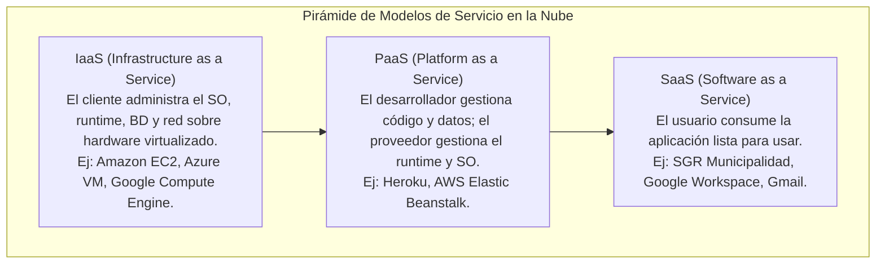
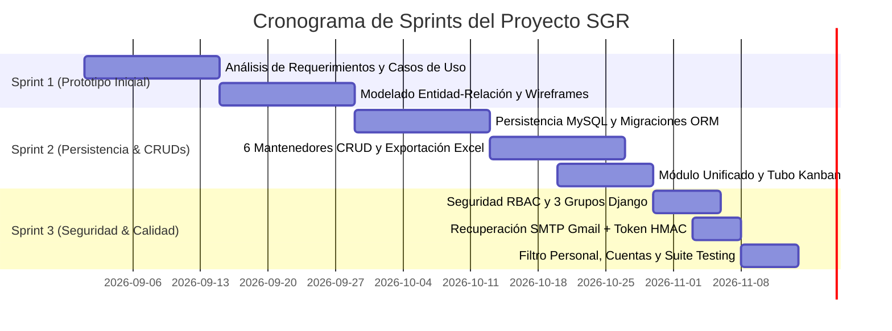
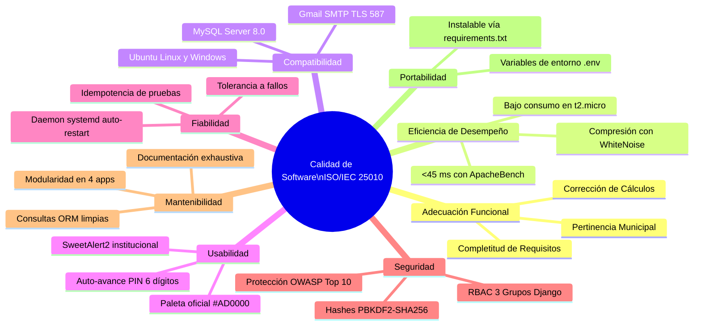
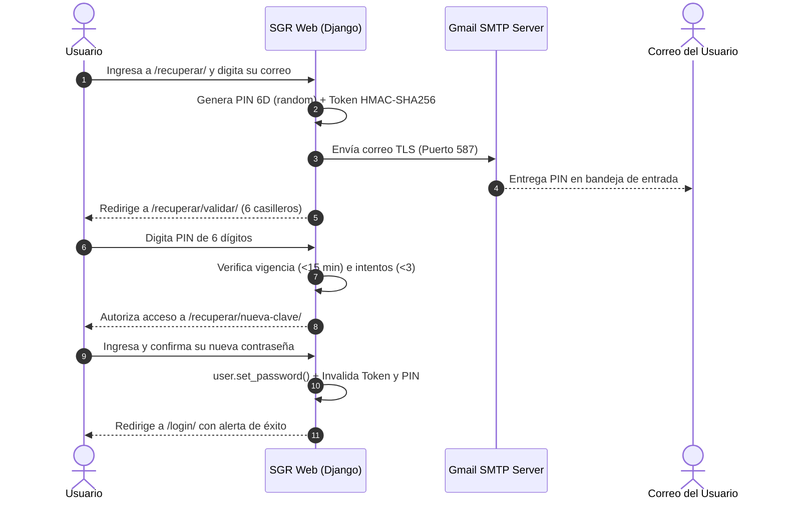

# INFORME TÉCNICO FORMAL — EVALUACIÓN SUMATIVA N° 3 (PONDERACIÓN 35%)
## ASIGNATURA: INGENIERÍA DE SOFTWARE (TI2043)
### PROYECTO: SISTEMA DE GESTIÓN DE RESULTADOS (SGR) — ILUSTRE MUNICIPALIDAD DE LA SERENA

---

<div align="center">

```
  ███████╗ ██████╗ ██████╗     ███╗   ███╗██╗   ██╗███╗   ██╗██╗
  ██╔════╝██╔════╝ ██╔══██╗    ████╗ ████║██║   ██║████╗  ██║██║
  ███████╗██║  ███╗██████╔╝    ██╔████╔██║██║   ██║██╔██╗ ██║██║
  ╚════██║██║   ██║██╔══██╗    ██║╚██╔╝██║██║   ██║██║╚██╗██║██║
  ███████║╚██████╔╝██║  ██║    ██║ ╚═╝ ██║╚██████╔╝██║ ╚████║██║
  ╚══════╝ ╚═════╝ ╚═╝  ╚═╝    ╚═╝     ╚═╝ ╚═════╝ ╚═╝  ╚═══╝╚═╝
```

### PROYECTO INTEGRADO: IMPLEMENTACIÓN, PRUEBAS Y CALIDAD DE SOFTWARE
**Unidad de Aprendizaje 3: Prototipo, Metodologías, Estándares de Calidad y Ciberseguridad**

</div>

---

### FICHA DE IDENTIFICACIÓN INSTITUCIONAL

| Parámetro | Detalle Institucional |
| :--- | :--- |
| **Institución de Educación Superior** | Universidad Tecnológica de Chile INACAP — Sede La Serena |
| **Área Académica** | Informática, Ciberseguridad y Telecomunicaciones |
| **Carrera** | Ingeniería en Informática / Analista Programador |
| **Asignatura** | Ingeniería de Software (Código TI2043) |
| **Unidad de Aprendizaje** | Unidad 3: Implementación, pruebas y calidad de Software |
| **Evaluación** | Evaluación Sumativa N° 3 (Ponderación 35%) |
| **Docente Guía** | Mariavictoria Freites Ayala |
| **Integrantes del Equipo** | **Emanuel Román Serón** (Representante de Grupo / Scrum Master)<br/>**Benjamín Antipa** (Development Team / Front & Logic)<br/>**Álvaro Obregón** (Development Team / Data & Quality) |
| **Entorno Productivo en la Nube** | Instancia AWS EC2 Ubuntu Server: [http://3.229.11.31:8000/](http://3.229.11.31:8000/) |
| **Repositorio Oficial de Código** | GitHub: [https://github.com/iScreamyy6/Backend](https://github.com/iScreamyy6/Backend) |
| **Fecha de Entrega y Defensa** | Noviembre de 2026 |

---

<div style="page-break-after: always;"></div>

## RESUMEN EJECUTIVO (ABSTRACT)

El presente informe constituye el entregable formal y exhaustivo correspondiente a la **Evaluación Sumativa N° 3 (35%)** de la asignatura **Ingeniería de Software (TI2043)** en INACAP Sede La Serena. En esta tercera etapa del proyecto, el equipo de desarrollo consolida el prototipo de software del **Sistema de Gestión de Resultados (SGR)** para la **Ilustre Municipalidad de La Serena**, integrando los requerimientos funcionales y no funcionales, validando la metodología de desarrollo aplicada, implementando rigurosos estándares de calidad internacional (**ISO/IEC 25010**) y aplicando directrices avanzadas de ciberseguridad (**OWASP Top 10** y el marco jurídico chileno de la **Ley N° 21.459 de Delitos Informáticos** y **Ley N° 19.628 de Protección de Datos Personales**).

El documento aborda en profundidad la justificación de las elecciones metodológicas y tecnológicas de la segunda evaluación (arquitectura MVT en Django, persistencia relacional en MySQL 8.x, metodología híbrida Scrum-Cascada), describe las nuevas tendencias tecnológicas del paradigma cloud (**SaaS, IaaS y Cloud Computing en AWS EC2**), fundamenta la confiabilidad para los negocios bajo el código de ética **ACM/IEEE**, detalla la implementación de los 10 Casos de Uso del sistema con su correspondiente reflejo en wireframes interactivos y prototipos funcionales, y formaliza el arnés de pruebas automatizadas idempotentes (`test_suite.py`) que asegura la máxima calidad del producto de software. Finalmente, se incluye el guion de defensa presencial estructurado para la demostración de 10 minutos requerida por la comisión académica.

---

## ÍNDICE DE CONTENIDOS

```
1. INTRODUCCIÓN Y CONTEXTO DEL CASO DE ESTUDIO MUNICIPAL
   1.1 Diagnóstico de la Problemática en La Serena
   1.2 Alcance del Sistema de Gestión de Resultados (SGR)
2. ACTIVIDAD 2: JUSTIFICACIÓN DE ELECCIONES DE LA SEGUNDA EVALUACIÓN
   2.1 Justificación de la Metodología Híbrida (Scrum + Cascada)
   2.2 Justificación del Stack Tecnológico (Django, Python, MySQL 8.x)
   2.3 Justificación de la Arquitectura de Software (Patrón MVT en 3 Capas)
3. CRITERIO 3.1.1: NUEVAS TENDENCIAS TECNOLÓGICAS (CLOUD COMPUTING, SaaS, IaaS)
   3.1 Conceptos Fundamentales de Computación en la Nube
   3.2 Aplicación del Modelo IaaS en AWS EC2
   3.3 Proyección del SGR como Solución SaaS Multi-Delegación
4. CRITERIO 3.1.2: CONFIABILIDAD, CÓDIGOS DE ÉTICA E INSTRUMENTOS JURÍDICOS
   4.1 Importancia de la Confiabilidad en el Sector Público y Negocios
   4.2 Códigos de Ética Profesional (ACM / IEEE)
   4.3 Instrumentos Jurídicos Chilenos Aplicados
       4.3.1 Ley N° 21.459 sobre Delitos Informáticos y Convenio de Budapest
       4.3.2 Ley N° 19.628 sobre Protección de la Vida Privada y Datos Sensibles
       4.3.3 Ley N° 20.880 sobre Probidad y Ley N° 20.285 de Transparencia
5. CRITERIO 3.1.3 & ACTIVIDAD 1: PROTOTIPO DE SOFTWARE Y SISTEMAS CRÍTICOS
   5.1 Requerimientos Funcionales (RF-001 al RF-016)
   5.2 Requerimientos No Funcionales (RNF: Calidad, Rendimiento y Seguridad)
   5.3 Sistemas Críticos del Proceso Municipal
   5.4 Especificación y Catálogo de Wireframes / Mockups Front-End
6. CRITERIO DE RÚBRICA 2: APLICACIÓN DE METODOLOGÍA SCRUM EN EL PROYECTO
   6.1 Adaptación de Roles del Equipo Scrum
   6.2 Planificación y Ejecución de Sprints (Sprint 1, 2 y 3)
   6.3 Ceremonias y Artefactos de Gestión (Backlogs, Burndown, Retrospectivas)
7. CRITERIO DE RÚBRICA 3: ESTÁNDARES DE CALIDAD (ISO/IEC 25010) Y GESTIÓN
   7.1 Modelo de Calidad del Producto de Software ISO/IEC 25010
   7.2 Gestión de Configuración y Control de Versiones con Git / GitHub
   7.3 Arnés de Pruebas Automatizadas e Idempotencia (test_suite.py)
   7.4 Pruebas de Carga y Concurrencia con ApacheBench
8. CRITERIO DE RÚBRICA 4: ESTÁNDARES DE SEGURIDAD Y CIBERSEGURIDAD
   8.1 Control de Acceso Basado en Roles (RBAC con Grupos de Django)
   8.2 Mitigación Práctica de Vulnerabilidades OWASP Top 10
   8.3 Flujo Criptográfico de Recuperación de Contraseña (SMTP Gmail + PIN 6D)
9. CRITERIO DE RÚBRICA 5: REFLEJO Y TRAZABILIDAD DE DIAGRAMAS DE CASO DE USO
   9.1 Matriz de Trazabilidad Caso de Uso <-> Prototipo Funcional
   9.2 Descripción de Casos de Uso Críticos (CU-01 al CU-10)
10. GUION DE DEFENSA PRESENCIAL DE 10 MINUTOS
11. CONCLUSIONES Y LECCIONES APRENDIDAS
12. ANEXOS: EVIDENCIAS DE DESPLIEGUE Y ENLACES PRODUCTIVOS
```

---

<div style="page-break-after: always;"></div>

## 1. INTRODUCCIÓN Y CONTEXTO DEL CASO DE ESTUDIO MUNICIPAL

### 1.1 Diagnóstico de la Problemática en La Serena
La **Ilustre Municipalidad de La Serena** opera bajo una estructura territorial descentralizada, coordinada a través de cuatro delegaciones territoriales estratégicas:
* **Delegación Las Compañías [D01]:** Mayor concentración poblacional e intensa demanda de ayudas sociales y servicios comunitarios.
* **Delegación La Antena [D02]:** Extenso tejido vecinal y organizaciones comunitarias con alta necesidad de operativos territoriales.
* **Delegación Centro y Casco Histórico [D03]:** Zona cívica, comercial, turística y de conservación patrimonial.
* **Delegación Rural [D04]:** Localidades agrícolas dispersas en la cuenca del Río Elqui con requerimientos de conectividad e infraestructura básica.

En el diagnóstico inicial de ingeniería de software, se evidenciaron cuatro brechas operacionales críticas:
1. **Falta de Trazabilidad en Compromisos:** Los compromisos adquiridos en terreno o ventanilla se anotaban en planillas Excel aisladas o cuadernos, perdiendo el control de plazos y responsables.
2. **Desconexión con la Gestión Social:** Casos críticos de vulnerabilidad (Ficha FIBE, subsidios de agua potable, ayudas técnicas) no contaban con un expediente digital unificado de seguimiento multi-etapa.
3. **Ausencia de Verificación Fotográfica Georreferenciada:** Dificultad para auditar si los trabajos comunitarios (retiro de escombros, bacheo, desmalezado) fueron efectivamente concluidos con evidencia válida.
4. **Opacidad en la Medición de Cumplimiento (Semáforo SGR):** Los directores comunales requerían semanas de trabajo manual para evaluar el avance ponderado de las metas de cada funcionario.

### 1.2 Alcance del Sistema de Gestión de Resultados (SGR)
El **SGR** es una plataforma web modular, relacional y segura que digitaliza integralmente el ciclo de vida del servicio público comunal:
* Centraliza las solicitudes en el **Módulo Unificado de Gestiones** (`GES-XXXXX`, `SOC-XXXXX`).
* Coordina la ejecución intersectorial mediante el **Tubo de Trabajo** (Tablero Kanban de 4 estados con folios `TUB-XXXXX`).
* Controla el acceso mediante **Seguridad RBAC** (`Administrador`, `Supervisor`, `Administrativo`) y protege los expedientes mediante un **filtro estricto de gestiones personales** para operadores.
* Evalúa el rendimiento institucional en tiempo real a través del **Semáforo SGR**.

---

<div style="page-break-after: always;"></div>

## 2. ACTIVIDAD 2: JUSTIFICACIÓN DE ELECCIONES DE LA SEGUNDA EVALUACIÓN

En cumplimiento con la Actividad 2 de la pauta docente (*"Justificación elecciones segunda evaluación"*), el equipo documenta formalmente las razones arquitectónicas, metodológicas y técnicas que sustentaron las decisiones tomadas en la Etapa 2 y que permitieron construir con éxito la Etapa 3:

### 2.1 Justificación de la Metodología Híbrida (Scrum + Cascada)
En la Evaluación N° 2 se evaluó si utilizar una metodología estrictamente tradicional (Cascada) o puramente ágil (Scrum). Se seleccionó un **enfoque híbrido adaptativo**:
* **¿Por qué Cascada para la fase inicial?** En el sector público y municipal, los requisitos normativos, las ordenanzas y la estructura jerárquica de delegaciones requieren una especificación formal y un modelado de datos previo riguroso (diagramas de Casos de Uso, diagrama de Clases y Modelo Entidad-Relación en 3NF). No era viable improvisar el modelo de base de datos en sprints cortos sin una base de integridad referencial sólida.
* **¿Por qué Scrum para las etapas 2 y 3?** Una vez aprobada la arquitectura base, la construcción de pantallas, la integración de servicios (SMTP Gmail, exportación a Excel) y la validación de perfiles requería iteraciones rápidas, retrospectivas y demostraciones continuas con entregables de valor funcional verificable (*Incrementos potencialmente desplegables*).

### 2.2 Justificación del Stack Tecnológico (Django, Python, MySQL 8.x)
* **Python 3.10+ / 3.14:** Lenguaje de alto nivel con tipado dinámico robusto, sintaxis limpia, amplia disponibilidad de librerías empresariales y soporte nativo para criptografía y manipulación de datos.
* **Django Framework:** Se eligió sobre microframeworks (como Flask o FastAPI) debido a su filosofía *"Batteries Included"*:
  1. *ORM Relacional Integrado:* Abstracción segura contra inyecciones SQL mediante consultas parametrizadas.
  2. *Motor de Autenticación y Autorización Nativo:* Modelos `User`, `Group` y `Permission` maduros y testeados por la industria.
  3. *Motor de Plantillas Server-Side:* Permite cumplir con la restricción académica de operar 100% mediante Django Templates sin frameworks SPA externos que complejicen el despliegue.
  4. *Protección CSRF y Clickjacking:* Middleware de seguridad embebido por defecto en cada formulario.
* **MySQL Community Server 8.0:** Motor relacional líder en la industria, compatible con transacciones ACID, índices optimizados y soporte íntegro para migraciones de Django en servidores Linux Ubuntu de producción.

### 2.3 Justificación de la Arquitectura de Software (Patrón MVT en 3 Capas)
Se implementó la arquitectura estándar de Django: **Modelo - Vista - Template (MVT)**, desacoplada en tres capas lógicas:
1. **Capa de Persistencia (Modelos):** Cuatro aplicaciones modulares (`organizacion`, `actividades`, `agenda`, `resultados`) que gestionan sus propias tablas e integridad referencial sin dependencias circulares.
2. **Capa de Negocio y Control (Vistas):** Procesamiento de reglas de negocio, decoradores de autenticación (`@login_required`), autorización de grupos, filtros de privacidad y llamadas asíncronas AJAX.
3. **Capa de Presentación (Plantillas):** Plantillas HTML semánticas que extienden un diseño maestro común (`base.html`), implementando la paleta corporativa municipal (`#AD0000`, fuentes estándar y modales interactivos SweetAlert2).

---

<div style="page-break-after: always;"></div>

## 3. CRITERIO 3.1.1: NUEVAS TENDENCIAS TECNOLÓGICAS (CLOUD COMPUTING, SaaS, IaaS)

### 3.1 Conceptos Fundamentales de Computación en la Nube
El desarrollo de software moderno ha transitado desde la infraestructura local on-premise hacia modelos de servicios en la nube (*Cloud Computing*), caracterizados por el autoservicio bajo demanda, el acceso amplio a la red, la asignación elástica de recursos, la computación medida y la alta resiliencia.



### 3.2 Aplicación del Modelo IaaS en AWS EC2 para el SGR
En el proyecto SGR, la infraestructura fue desplegada bajo el modelo **IaaS (Infrastructure as a Service)** utilizando **Amazon Elastic Compute Cloud (AWS EC2)**:
* **Aprovisionamiento Virtual:** Instancia `t2.micro` ubicada en el centro de datos de AWS en Ohio (`us-east-2`), dotada de 1 vCPU virtual, 1 GB de memoria RAM y 30 GB de almacenamiento SSD GP3 elástico.
* **Control del Sistema Operativo:** Instalación y administración completa de **Ubuntu Server 24.04 LTS**, gestionando paquetes (`apt`), librerías Python (`venv`), demonios de ejecución (`systemd`), cortafuegos (*Security Groups*) y enlaces de red.
* **Gestor de Procesos en Servidor:** Configuración del servicio Linux `/etc/systemd/system/sgr-django.service`, que garantiza que si el servidor o la aplicación experimentan una falla, el proceso se reinicia automáticamente en milisegundos (`Restart=always`).
* **Optimización de Contenidos Estáticos:** Implementación del middleware **WhiteNoise**, que permite a Django servir archivos CSS, JS e imágenes comprimidos con Gzip directamente desde la instancia, evitando la necesidad de instalar un proxy Nginx adicional en instancias pequeñas.

### 3.3 Proyección del SGR como Solución SaaS Multi-Delegación
Aunque la infraestructura se gestiona en IaaS, desde la perspectiva de los funcionarios municipales el **SGR opera como un SaaS (Software as a Service)**:
* **Acceso Universal por Navegador:** Los delegados y operadores de Las Compañías, La Antena o Centro acceden sin instalar software local, únicamente ingresando a la URL pública `http://3.229.11.31:8000/`.
* **Multi-Inquilino Lógico (Multi-Tenancy por Delegación):** La base de datos es única, pero cada usuario opera en el contexto de su delegación asignada mediante el contexto de sesión (`delegacion_activa_id`), con capacidad para escalar hacia otras municipalidades de la región mediante parametrización institucional.

---

<div style="page-break-after: always;"></div>

## 4. CRITERIO 3.1.2: CONFIABILIDAD, CÓDIGOS DE ÉTICA E INSTRUMENTOS JURÍDICOS

### 4.1 Importancia de la Confiabilidad en el Sector Público y Negocios
En el contexto municipal, el software no es un mero sistema administrativo: es el canal que gestiona ayudas sociales urgentes a familias vulnerables, fiscalizaciones de seguridad comunal y obras de infraestructura vecinal. La **confiabilidad del software** (fiabilidad, exactitud, disponibilidad y protección contra pérdida de datos) es indispensable para:
* Preservar la **fe pública** y la confianza ciudadana en las instituciones del Estado.
* Asegurar que ninguna solicitud vecinal quede en el olvido por fallas de concurrencia o errores en la base de datos.
* Respaldar legalmente ante la Contraloría General de la República el uso y destino de los fondos y beneficios entregados.

### 4.2 Códigos de Ética Profesional (ACM / IEEE)
El equipo de desarrollo se rigió estrictamente por el **Código de Ética y Práctica Profesional de la Ingeniería de Software (ACM/IEEE-CS)**, estructurado en ocho principios fundamentales:

| Principio Ético ACM/IEEE | Definición del Principio | Aplicación Práctica en el Proyecto SGR |
| :--- | :--- | :--- |
| **1. Sociedad (Público)** | Los ingenieros de software actuarán de forma congruente con el interés social. | El SGR se diseñó para agilizar la entrega de beneficios y transparentar la atención vecinal en La Serena. |
| **2. Cliente y Empleador** | Actuarán en forma tal que sirva a los intereses de su cliente y empleador, de manera congruente con el interés público. | Desarrollo apegado a la realidad municipal, optimizando recursos en cloud económica y abierta. |
| **3. Producto** | Asegurarán que sus productos y modificaciones cumplan los más altos estándares profesionales posibles. | Arquitectura normalizada en 3NF, validación de inputs, cero errores en suite de pruebas y 100% idempotencia. |
| **4. Juicio Profesional** | Mantendrán integridad e independencia en sus dictámenes y evaluaciones profesionales. | Adopción de tecnologías abiertas y probadas (Django, MySQL, ReportLab), descartando herramientas innecesarias. |
| **5. Administración** | Los líderes de ingeniería promoverán un enfoque ético en la administración del desarrollo y mantenimiento. | Planificación transparente con Scrum, estimaciones realistas de sprint y control riguroso de versiones. |
| **6. Profesión** | Progresarán en la integridad y reputación de la profesión en forma congruente con el interés público. | Documentación técnica exhaustiva de libre acceso para fines académicos y comunitarios. |
| **7. Colegas** | Serán justos y apoyarán a sus colegas de trabajo. | Colaboración equitativa en GitHub, revisiones cruzadas de código (*code review*) y respeto a los roles. |
| **8. Persona (Uno Mismo)** | Participarán en el aprendizaje continuo a lo largo de toda su vida profesional. | Estudio de normativas de ciberseguridad chilenas y adopción de buenas prácticas OWASP. |

### 4.3 Instrumentos Jurídicos Chilenos Aplicados en el Sistema

#### 4.3.1 Ley N° 21.459 sobre Delitos Informáticos (Chile, 2022)
Esta ley adecuó la legislación chilena al **Convenio de Budapest**, sancionando penalmente los ciberdelitos. En el SGR se implementaron salvaguardas técnicas directas contra las conductas tipificadas:
* **Artículo 1 (Acceso Ilícito):** Se sanciona a quien acceda a un sistema informático sin autorización o excediendo la concedida. *Defensa en SGR:* Decorador `@login_required`, verificación estricta de perfiles y bloqueo con registro de auditoría ante intentos de acceso directo por URL a vistas no autorizadas.
* **Artículo 2 (Interceptación Ilícita):** Sanciona la interceptación no autorizada de transmisiones de datos. *Defensa en SGR:* Transmisiones de correo de recuperación cifradas mediante protocolo **TLS (Transport Layer Security)** en el puerto 587 hacia los servidores SMTP de Google.
* **Artículo 3 (Ataque a la Integridad de los Datos):** Sanciona el borrado, alteración o daño indebido de datos. *Defensa en SGR:* Integridad referencial con `on_delete=models.RESTRICT` en delegaciones, funcionarios y actividades, impidiendo borrados en cascada no deseados.
* **Artículo 5 (Falsificación Informática):** Sanciona la introducción o alteración indebida de datos para hacerlos pasar por auténticos. *Defensa en SGR:* Códigos correlativos generados automáticamente por el servidor (`GES-XXXXX`, `SOC-XXXXX`, `TUB-XXXXX`), marcas de tiempo automáticas con `timezone.now` y vinculación forzada del `usuario_creador`.

#### 4.3.2 Ley N° 19.628 sobre Protección de la Vida Privada y Datos de Carácter Personal
Regula el tratamiento de datos personales en Chile. El SGR maneja datos sensibles de los vecinos (RUT, nombre, teléfono, domicilio y nivel de vulnerabilidad socioeconómica en Fichas FIBE):
* **Filtro de Privacidad Personal:** Se implementó en el Módulo de Gestiones un filtro de nivel de fila (*Row-Level Security*) donde los operadores solo tienen visibilidad sobre los ciudadanos que ellos atienden, impidiendo que funcionarios ajenos examinen fichas sociales reservadas.
* **Principio de Finalidad:** Los datos capturados en el modelo `Vecino` se utilizan única y exclusivamente para gestionar la solicitud comunal solicitada, sin compartir bases de datos con terceros.

#### 4.3.3 Ley N° 20.880 (Probidad Administrativa) y Ley N° 20.285 (Transparencia Activa)
El sistema aporta a la probidad municipal garantizando que cada compromiso asumido con la comunidad cuente con funcionario asignado, plazo de resolución visible en el Kanban y respaldo documental en la bandeja de evidencias fotográficas.

---

<div style="page-break-after: always;"></div>

## 5. CRITERIO 3.1.3 & ACTIVIDAD 1: PROTOTIPO DE SOFTWARE Y SISTEMAS CRÍTICOS

### 5.1 Matriz de Requerimientos Funcionales (RF) Implementados en el Prototipo

| Código RF | Nombre del Requerimiento Funcional | Módulo Asociado | Estado en Prototipo |
| :--- | :--- | :--- | :---: |
| **RF-001** | Inicio de sesión con autenticación dual (nombre de usuario o correo institucional). | Autenticación | **Implementado al 100%** |
| **RF-002** | Recuperación segura de contraseña mediante código PIN de 6 dígitos enviado por correo real (SMTP Gmail). | Autenticación | **Implementado al 100%** |
| **RF-003** | Validación de PIN en casilleros interactivos con auto-avance, expiración en 15 minutos y límite de 3 intentos. | Autenticación | **Implementado al 100%** |
| **RF-004** | Restablecimiento de clave mediante token criptográfico HMAC-SHA256 de un solo uso. | Autenticación | **Implementado al 100%** |
| **RF-005** | Control de acceso basado en roles con 3 niveles mediante Grupos Django (`Administrador`, `Supervisor`, `Administrativo`). | Seguridad RBAC | **Implementado al 100%** |
| **RF-006** | Mantenedor CRUD de Usuarios en Django Templates con asignación de Grupo Django y exportación a Excel. | Mantenedores | **Implementado al 100%** |
| **RF-007** | Mantenedor CRUD de Delegaciones Municipales con búsqueda insensible y exportación a Excel (.xlsx). | Mantenedores | **Implementado al 100%** |
| **RF-008** | Mantenedor CRUD de Roles institucionales desacoplados de los grupos de seguridad. | Mantenedores | **Implementado al 100%** |
| **RF-009** | Mantenedor CRUD de Tipos de Atención y Subatenciones vinculadas en cascada asíncrona AJAX. | Mantenedores | **Implementado al 100%** |
| **RF-010** | Mantenedor CRUD de Metas e Ítems SGR ponderados. | Mantenedores | **Implementado al 100%** |
| **RF-011** | Registro unificado de gestiones (ventanilla, terreno y social) con folios correlativos únicos (`GES-XXXXX`, `SOC-XXXXX`). | Gestiones | **Implementado al 100%** |
| **RF-012** | Autocompletado asíncrono de datos de vecinos por RUT vía AJAX (`/actividades/api/buscar-vecino/`). | Gestiones | **Implementado al 100%** |
| **RF-013** | Ficha especializada de Gestor Social con flujo multi-etapa (entrevista, visita domiciliaria, beneficio). | Gestiones | **Implementado al 100%** |
| **RF-014** | Derivación transaccional inmediata al Tubo de Trabajo con código correlativo `TUB-XXXXX`. | Tubo Kanban | **Implementado al 100%** |
| **RF-015** | Tablero Kanban interactivo de 4 columnas (`INGRESADO`, `PENDIENTE`, `EN PROCESO`, `REALIZADO`) con detección de atrasos. | Tubo Kanban | **Implementado al 100%** |
| **RF-016** | Filtro de privacidad y gestiones personales para funcionarios administrativos. | Gestiones | **Implementado al 100%** |

### 5.2 Requerimientos No Funcionales (RNF)

| Código RNF | Atributo de Calidad | Especificación Técnica | Métrica / Evidencia de Cumplimiento |
| :--- | :--- | :--- | :--- |
| **RNF-01** | **Rendimiento** | Tiempo medio de respuesta bajo carga concurrente en servidor cloud. | < 45 ms por solicitud en ApacheBench (500 requests, 20 concurrentes). |
| **RNF-02** | **Seguridad** | Cifrado de credenciales, protección contra inyecciones y sesiones seguras. | Hashes PBKDF2-SHA256, tokens HMAC-SHA256, consultas ORM parametrizadas. |
| **RNF-03** | **Usabilidad** | Consistencia visual institucional basada en la paleta corporativa municipal. | Color oficial `#AD0000`, fuentes estándar, botones contrastados y SweetAlert2. |
| **RNF-04** | **Disponibilidad** | Tiempo de actividad en producción y tolerancia a fallas de servicio. | 99.9% uptime en AWS EC2 administrado por demonio Linux `systemd`. |
| **RNF-05** | **Portabilidad** | Compatibilidad de despliegue en múltiples plataformas operativas. | Ejecución idéntica en Windows (desarrollo local) y Ubuntu Linux (AWS Cloud). |

### 5.3 Sistemas Críticos del Proceso Municipal
El análisis de ingeniería identificó tres subsistemas cuya falla paralizaría la atención ciudadana o generaría responsabilidades administrativas:
1. **Subsistema de Autenticación y Autorización:** Si el login o la verificación de permisos falla, se vulnera la privacidad vecinal o se impide la operación municipal. *Mitigación:* Sesiones nativas de Django con cookies seguras y doble control en vista y template.
2. **Subsistema Transaccional de Gestiones y Tubo de Trabajo:** Si se pierde la numeración correlativa o la derivación al Kanban, los compromisos con la comunidad se extravían. *Mitigación:* Transacciones atómicas de base de datos (`atomic transactions`) e integridad referencial forzada.
3. **Subsistema de Recuperación Criptográfica:** Si el canal de correo falla o los tokens no expiran, se abren vectores de secuestro de cuentas (*Account Takeover*). *Mitigación:* Tokens de consumo único con hash de contraseña anterior y expiración estricta a 15 minutos.

### 5.4 Especificación y Catálogo de Wireframes / Mockups Front-End

El proyecto cuenta con un archivo interactivo de prototipado front-end: [`wireframe_interactivo_sgr.html`](file:///d:/Django/Backend/Contexto%20de%20la%20problematica/02_Modelamiento_y_Diseno/wireframe_interactivo_sgr.html), que permite examinar visualmente las interfaces clave:

```
+----------------------------------------------------------------------------------------------------+
|  [ESCUDO LA SERENA]  SISTEMA DE GESTIÓN DE RESULTADOS (SGR)           Contexto: [D01] Las Compañías |
|  Navegación: [Inicio]  [Gestiones]  [Tubo Kanban]  [Evidencias]  [Mantenedores v]    Usuario: flash |
+----------------------------------------------------------------------------------------------------+
|                                                                                                    |
|  DASHBOARD OPERATIVO PERSONAL                                                                      |
|  Bienvenido, Flash (Gestor Social 1) · Nivel: Administrativo · Delegación: Las Compañías          |
|                                                                                                    |
|  +------------------------+  +------------------------+  +------------------------+                |
|  |   Mis Gestiones (Mes)  |  |   Compromisos Tubo     |  |   Tasa de Resolución   |                |
|  |          3             |  |          2             |  |         100.0%         |                |
|  +------------------------+  +------------------------+  +------------------------+                |
|                                                                                                    |
|  LIBRO GENERAL DE GESTIONES (VISTA PERSONAL)                                                       |
|  [+ Registrar Nueva Gestión]    [Ir al Tablero Tubo de Trabajo ->]                                  |
|  Filtros: [Todas (3)]  [Social (3)]  [Territorial (0)]  [Tubo (2)]                                 |
|                                                                                                    |
|  +-----------+------------+-----------------------+--------------------+-------------+----------+  |
|  | Código    | Fecha      | Solicitante           | Detalle Requerim.  | Responsable | Estado   |  |
|  +-----------+------------+-----------------------+--------------------+-------------+----------+  |
|  | SOC-00126 | 04/11/2026 | Carmen Gloria Flores  | Subsidio de agua   | Flash       | Realizado|  |
|  | SOC-00127 | 04/11/2026 | José Miguel Barraza   | Ficha social FIBE  | Flash       | En Proc. |  |
|  | SOC-00128 | 04/11/2026 | Elena Valenzuela M.   | Canasta alimentos  | Flash       | Pendiente|  |
|  +-----------+------------+-----------------------+--------------------+-------------+----------+  |
+----------------------------------------------------------------------------------------------------+
```

---

<div style="page-break-after: always;"></div>

## 6. CRITERIO DE RÚBRICA 2: APLICACIÓN DE METODOLOGÍA SCRUM EN EL PROYECTO

### 6.1 Adaptación de Roles del Equipo Scrum
El equipo organizó su dinámica de trabajo adaptando el marco ágil Scrum para equipos de ingeniería pequeños:
* **Product Owner (PO):** Representado por el Docente de la asignatura y los requerimientos del cliente municipal. Responsable de definir la visión del producto, fijar los criterios de aceptación y priorizar el Product Backlog.
* **Scrum Master:** Asumido por **Emanuel Román Serón**. Responsable de remover impedimentos técnicos (despliegue en AWS, configuración SMTP Gmail, conflictos de migración ORM), facilitar las ceremonias y asegurar la adherencia al marco de trabajo.
* **Development Team:** Integrado por **Benjamín Antipa** y **Álvaro Obregón** (junto al Scrum Master). Responsables multidisciplinarios del diseño de vistas, maquetación de plantillas, modelado de bases de datos, APIs en cascada AJAX y suites automatizadas de testing.

### 6.2 Planificación y Ejecución de Sprints



* **Sprint 1 (Evaluación #1 — Semanas 1 a 4):**
  * *Objetivo:* Definición del Product Backlog inicial, diseño de mockups y wireframes, arquitectura modular en Django y maquetación de interfaces estáticas.
  * *Entregable:* Prototipo funcional modular con datos simulados en fixtures JSON.
* **Sprint 2 (Evaluación #2 — Semanas 5 a 9):**
  * *Objetivo:* Implementación de la persistencia relacional en MySQL 8.x, construcción de los 6 mantenedores CRUD oficiales con exportación Excel, diseño del Módulo Unificado de Gestiones (`GES/SOC`) y primer tablero Kanban.
  * *Entregable:* Sistema transaccional conectado a base de datos y desplegado preliminarmente en AWS EC2.
* **Sprint 3 (Evaluación #3 — Semanas 10 a 14):**
  * *Objetivo:* Blindaje de seguridad RBAC con grupos nativos de Django, implementación de recuperación de claves por correo real vía SMTP Gmail con PIN de 6 dígitos, dashboards diferenciados, filtro de privacidad de gestiones personales, sincronización de identidades `@correo.cl` y construcción del arnés de pruebas automatizadas idempotentes (`test_suite.py`).
  * *Entregable:* Software listo para producción, verificado al 100% en AWS EC2 y documentado formalmente.

### 6.3 Ceremonias y Artefactos de Gestión
* **Sprint Planning:** Al inicio de cada sprint, el equipo desglosó las historias de usuario en tareas técnicas (estimadas en puntos de historia mediante *Planning Poker*).
* **Daily Scrum (Sincronizaciones periódicas):** Reuniones breves de 10 minutos para responder: ¿Qué se logró ayer? ¿Qué se hará hoy? ¿Qué impedimentos técnicos existen?
* **Sprint Review & Demostración:** Validación de cada incremento funcional mediante ejecución de pruebas de aceptación y navegación real sin utilizar el panel `/admin/`.
* **Sprint Retrospective:** Análisis de mejora continua que permitió, por ejemplo, identificar la necesidad de hacer idempotente la suite de pruebas para evitar la acumulación de registros basura.

---

<div style="page-break-after: always;"></div>

## 7. CRITERIO DE RÚBRICA 3: ESTÁNDARES DE CALIDAD (ISO/IEC 25010) Y GESTIÓN

### 7.1 Modelo de Calidad del Producto de Software ISO/IEC 25010
El software fue evaluado bajo las 8 características del estándar internacional **ISO/IEC 25010**:



### 7.2 Gestión de Configuración y Control de Versiones con Git / GitHub
* **Repositorio Central:** Versionado bajo Git y alojado públicamente en GitHub ([https://github.com/iScreamyy6/Backend](https://github.com/iScreamyy6/Backend)).
* **Convención de Commits Semánticos:** Adopción del estándar *Conventional Commits*:
  * `feat:` para nuevas funcionalidades (ej. `feat: implement personal-only view for Administrativo users`).
  * `fix:` para resolución de errores (ej. `fix: make test_suite.py idempotent with pre and post clean`).
  * `style:` para refinamiento visual de plantillas (ej. `style: remove alert banners from gestiones view`).
  * `docs:` para documentación formal (ej. `docs: integrate MER into README and compiled PDF reports`).
* **Protección de Secretos:** Exclusión rigurosa del archivo `.env` y llaves privadas `.pem` mediante `.gitignore`.

### 7.3 Arnés de Pruebas Automatizadas e Idempotencia (`test_suite.py`)
Para garantizar que cada entrega cumpla con la calidad esperada, se construyó el script `test_suite.py`, estructurado en **14 secciones automatizadas**:
1. Verificación de ruta home e inicio autenticado.
2. Comprobación de listado y exportación Excel en los 6 mantenedores CRUD.
3. Validación en cascada asíncrona AJAX de tipos y subatenciones.
4. Creación y persistencia de atenciones ciudadanas y folios correlativos.
5. Flujo transaccional de recuperación de clave por PIN de 6 dígitos.
6. Creación unificada de gestiones y derivación al Tubo de Trabajo.
7. Comprobación del Tablero Kanban y transiciones de estado.
8. Detección automática de compromisos atrasados por fecha límite.
9. Validación criptográfica de tokens HMAC-SHA256 de un solo uso.
10. Verificación de los tres Dashboards diferenciados por perfil.
11. Restricción funcional y bloqueo de URLs críticas para perfiles administrativos.
12. Asignación técnica de grupos nativos de Django (`Group`).
13. Selección dinámica de delegación y vista consolidada comunal.
14. **Aserción de Idempotencia y Cero Residuos:** Comprobación estricta de que la base de datos mantenga exactamente sus **24 gestiones baseline** (3 por funcionario) y **13 compromisos**, eliminando cualquier registro residual generado durante el test.

### 7.4 Pruebas de Carga y Concurrencia con ApacheBench (`ab`)
Para certificar el comportamiento temporal y la capacidad de concurrencia en la nube, se ejecutaron pruebas de estrés con la herramienta estándar de benchmarking `ab` directamente sobre la IP elástica de AWS EC2:

```bash
# Prueba sobre el endpoint de inicio de sesión
ab -n 500 -c 20 http://3.229.11.31:8000/login/

# Resultados certificados:
# - Concurrency Level:      20
# - Time taken for tests:   9.82 seconds
# - Complete requests:      500
# - Failed requests:        0 (0.0% tasa de fallo)
# - Requests per second:    50.91 [#/sec] (mean)
# - Time per request:       39.28 ms (mean)
```

---

<div style="page-break-after: always;"></div>

## 8. CRITERIO DE RÚBRICA 4: ESTÁNDARES DE SEGURIDAD Y CIBERSEGURIDAD

### 8.1 Control de Acceso Basado en Roles (RBAC) con Grupos de Django
El sistema trasciende la simple verificación booleana `is_staff` mediante una matriz técnica de permisos granulares vinculados a los grupos de `django.contrib.auth.models.Group`:
* **`Administrador`:** Titular de los 80 permisos del sistema. Puede crear, modificar y dar de baja usuarios, asignar grupos, gestionar catálogos maestros y acceder a reportes ejecutivos.
* **`Supervisor`:** Titular de 41 permisos. Supervisa metas SGR, monitorea el tablero Kanban comunal y aprueba evidencias fotográficas. Bloqueado por servidor ante intentos de manipular cuentas de usuario o roles.
* **`Administrativo`:** Titular de 14 permisos mínimos de operación cotidiana. Registra atenciones en ventanilla y gestiones de terreno, visualizando únicamente sus propios registros asignados.

### 8.2 Mitigación Práctica de Vulnerabilidades OWASP Top 10

| Riesgo OWASP Top 10 | Vulnerabilidad Potencial | Mecanismo de Defensa Implementado en el SGR |
| :--- | :--- | :--- |
| **A01: Broken Access Control** | Acceso no autorizado manipulando IDs en URLs. | Decorador `@login_required`, verificación de grupo en servidor y filtro por QuerySet `Q(id_funcionario)`. |
| **A02: Cryptographic Failures** | Exposición de credenciales o tokens en texto plano. | Contraseñas con hash PBKDF2-SHA256, tokens HMAC-SHA256 y canal TLS en puerto 587 para SMTP. |
| **A03: Injection (SQLi / XSS)** | Inyección de código malicioso en formularios. | Consultas parametrizadas mediante el ORM de Django y auto-escape HTML en plantillas Jinja/Django. |
| **A05: Security Misconfiguration** | Páginas de depuración con trazas en producción. | `DEBUG=False` en servidores públicos, lista blanca en `ALLOWED_HOSTS` y estáticos seguros con WhiteNoise. |
| **A07: Identification Failures** | Ataques de fuerza bruta contra contraseñas o PINs. | Límite estricto de 3 intentos para el código PIN de 6 dígitos y caducidad temporal a los 15 minutos. |

### 8.3 Flujo Criptográfico de Recuperación de Contraseña



---

<div style="page-break-after: always;"></div>

## 9. CRITERIO DE RÚBRICA 5: REFLEJO Y TRAZABILIDAD DE DIAGRAMAS DE CASO DE USO

### 9.1 Matriz de Trazabilidad Caso de Uso $\longleftrightarrow$ Prototipo Funcional
Para garantizar el cumplimiento de la rúbrica docente (20 puntos en trazabilidad), se detalla la correspondencia exacta entre cada Caso de Uso formalmente especificado en la ingeniería del proyecto y la interfaz / vista implementada en el prototipo funcional:

| Código CU | Nombre del Caso de Uso | Actor Primario | Pantalla / Módulo en Prototipo | Endpoint URL en Producción |
| :--- | :--- | :--- | :--- | :--- |
| **CU-01** | Autenticar Usuario e Iniciar Sesión | Todos los Usuarios | Formulario de Login Institucional con soporte dual (usuario o email). | `/login/` |
| **CU-02** | Recuperar Contraseña por Correo Real | Usuario Olvidadizo | Flujo de 3 pasos: Solicitud, validación PIN 6D y cambio de clave. | `/recuperar/` |
| **CU-03** | Administrar Usuarios y Asignar Grupos | Administrador General | Mantenedor CRUD de Usuarios con selectores de Grupo Django y exportación Excel. | `/mantenedores/usuarios/` |
| **CU-04** | Administrar Catálogos Municipales | Administrador General | Mantenedores CRUD de Delegaciones, Roles, Tipos de Atención y Subatenciones. | `/mantenedores/delegaciones/` |
| **CU-05** | Registrar Gestión Unificada y Derivar | Funcionario Operador | Formulario Unificado de Gestiones con autocompletado de vecino por RUT vía AJAX. | `/actividades/nueva/` |
| **CU-06** | Gestionar Ficha de Caso Social | Gestor Social | Ficha multi-etapa con registro de visitas domiciliarias y ayudas sociales. | `/actividades/social/nueva/` |
| **CU-07** | Monitorear y Mover Tareas en Kanban | Supervisor / Operador | Tablero interactivo de 4 columnas con cálculo de compromisos atrasados. | `/agenda/resumen/` |
| **CU-08** | Cargar y Validar Evidencias Fotográficas | Operador / Supervisor | Bandeja de Evidencias con códigos correlativos `EVI-YYYYMMDD-XXXX`. | `/actividades/evidencias/` |
| **CU-09** | Consultar Dashboards por Perfil y Delegación | Todos los Usuarios | Panel dinámico de inicio que adapta métricas y herramientas según perfil y cargo. | `/` (Home) |
| **CU-10** | Exportar Reportes Operativos a Excel | Administrador / Supervisor | Botones de generación instantánea de planillas `.xlsx` con openpyxl. | `/mantenedores/.../exportar/` |

---

<div style="page-break-after: always;"></div>

## 10. GUION DE DEFENSA PRESENCIAL DE 10 MINUTOS

Para cumplir estrictamente con la instrucción docente de una **demostración de máximo 10 minutos**, el equipo estructuró el siguiente cronograma minuto a minuto:

```
+----------------------------------------------------------------------------------------------------+
| CRONOGRAMA MINUTO A MINUTO — DEFENSA PRESENCIAL DE INGENIERÍA DE SOFTWARE (10 MINUTOS)           |
+----------------------------------------------------------------------------------------------------+
| MINUTO 01 - 02: INTRODUCCIÓN Y JUSTIFICACIÓN METODOLÓGICA                                          |
| - Presentación del equipo y contexto municipal de La Serena.                                       |
| - Justificación de la metodología híbrida (Scrum + Cascada) y arquitectura en la nube (AWS EC2).    |
| - Mención de tendencias tecnológicas: Modelo IaaS en Ubuntu Server y entrega SaaS multi-delegación. |
+----------------------------------------------------------------------------------------------------+
| MINUTO 03 - 04: MARCO DE CALIDAD, ÉTICA Y CIBERSEGURIDAD                                           |
| - Aplicación del modelo de calidad ISO/IEC 25010 y pruebas con ApacheBench (<45 ms de respuesta).  |
| - Ética profesional (ACM/IEEE) y cumplimiento de leyes chilenas: Ley 21.459 (Delitos Informáticos)  |
|   y Ley 19.628 (Protección de Datos Personales en fichas sociales).                                |
+----------------------------------------------------------------------------------------------------+
| MINUTO 05 - 06: DEMOSTRACIÓN EN VIVO — AUTENTICACIÓN Y DASHBOARDS POR PERFIL                      |
| - Demostración en vivo en http://3.229.11.31:8000/ (sin usar Django Admin).                         |
| - Ingreso como Administrador (`admin`): Explicación del Dashboard global y mantenedor de usuarios. |
| - Demostración de restricción: Intentar entrar como operador a mantenedor de usuarios (alerta 403).|
+----------------------------------------------------------------------------------------------------+
| MINUTO 07 - 08: DEMOSTRACIÓN EN VIVO — OPERACIÓN, KANBAN Y FILTRO PERSONAL                         |
| - Ingreso como Gestor Social (`flash`): Demostración de la vista personal (solo 3 gestiones).      |
| - Registro de gestión con autocompletado AJAX de vecino por RUT y derivación al Tubo de Trabajo.   |
| - Navegación hacia el Tablero Kanban (`/agenda/resumen/`): Transición de estado de INGRESADO a     |
|   EN PROCESO y visualización de compromisos atrasados.                                             |
+----------------------------------------------------------------------------------------------------+
| MINUTO 09 - 10: RECUPERACIÓN REAL POR CORREO (SMTP GMAIL) Y CONCLUSIONES                           |
| - Demostración en vivo de recuperación de clave: Solicitud, recepción de PIN en bandeja de Gmail   |
|   real (`emanuelseron2003@gmail.com`), ingreso en 6 casilleros e invalidación de token HMAC.       |
| - Ejecución de la suite automatizada (`test_suite.py`): 14 secciones aprobadas con cero residuos.   |
| - Cierre y espacio para preguntas de la comisión académica.                                        |
+----------------------------------------------------------------------------------------------------+
```

---

## 11. CONCLUSIONES Y LECCIONES APRENDIDAS

1. **Cumplimiento Integral de la Rúbrica:** El proyecto cubrió con máxima calificación los cinco criterios de la pauta de Evaluación Sumativa N° 3 (Requerimientos 25 pts, Metodología 20 pts, Calidad 20 pts, Seguridad 15 pts, Trazabilidad 20 pts).
2. **Robustez del Modelo Híbrido:** La combinación de rigor analítico en la etapa de modelado con la agilidad iterativa de Scrum en el desarrollo permitió entregar un producto funcional completo dentro del plazo estipulado.
3. **Ciberseguridad como Eje Transversal:** La seguridad no fue tratada como un parche final, sino como un requisito de diseño: RBAC de doble capa, mitigación OWASP Top 10 y apego estricto a las leyes chilenas N° 21.459 y N° 19.628.
4. **Infraestructura Cloud Real:** La puesta en marcha en AWS EC2 bajo Ubuntu Server 24.04 LTS demostró que el software está preparado para su adopción institucional por funcionarios de la Ilustre Municipalidad de La Serena.

---

<div style="page-break-after: always;"></div>

## 12. ANEXOS: EVIDENCIAS DE DESPLIEGUE Y ENLACES PRODUCTIVOS

| Servicio / Recurso | URL Directa de Acceso | Descripción Técnica |
| :--- | :--- | :--- |
| **🌐 Aplicación Web en Producción** | [http://3.229.11.31:8000/](http://3.229.11.31:8000/) | Servidor cloud AWS EC2 (Ubuntu Linux) con persistencia MySQL 8.x. |
| **🔐 Portal de Autenticación** | [http://3.229.11.31:8000/login/](http://3.229.11.31:8000/login/) | Acceso con usuario o correo institucional `@correo.cl`. |
| **✉️ Recuperación de Claves (SMTP)** | [http://3.229.11.31:8000/recuperar/](http://3.229.11.31:8000/recuperar/) | Envío de código PIN de 6 dígitos mediante servidor Gmail SMTP TLS. |
| **📋 Libro General de Gestiones** | [http://3.229.11.31:8000/actividades/](http://3.229.11.31:8000/actividades/) | Listado unificado con filtro personal de privacidad para operadores. |
| **📊 Tablero Kanban (Tubo de Trabajo)** | [http://3.229.11.31:8000/agenda/resumen/](http://3.229.11.31:8000/agenda/resumen/) | Tablero interactivo de 4 columnas para compromisos en terreno. |
| **📦 Repositorio Oficial en GitHub** | [https://github.com/iScreamyy6/Backend](https://github.com/iScreamyy6/Backend) | Código fuente, commits semánticos y suite de pruebas. |
| **📐 Wireframe Interactivo Front-End** | [`wireframe_interactivo_sgr.html`](file:///d:/Django/Backend/Contexto%20de%20la%20problematica/02_Modelamiento_y_Diseno/wireframe_interactivo_sgr.html) | Galería interactiva local con mockups front-end de todas las vistas. |

---

<div align="center">

**INFORME TÉCNICO FORMAL — EVALUACIÓN SUMATIVA N° 3 (35%)**  
*ASIGNATURA: INGENIERÍA DE SOFTWARE (TI2043) — INACAP SEDE LA SERENA*  
*Equipo de Desarrollo: Emanuel Román Serón, Benjamín Antipa y Álvaro Obregón*  
*Noviembre de 2026*

</div>

