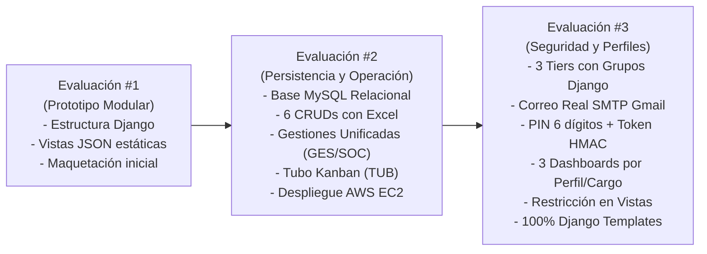

# Sistema de Gestión de Resultados (SGR)
## Ilustre Municipalidad de La Serena

**Institución:** INACAP — Sede La Serena  
**Carrera:** Ingeniería en Informática / Analista Programador  
**Asignatura:** Programación Back End (TI3041)  
**Evaluación Actual:** Evaluación Sumativa #3 (30%) — Aplicación Web con CRUD y Perfiles  
**Evaluaciones Anteriores Integradas:** Sumativa #1 (Prototipo Modular) · Sumativa #2 (Persistencia Relacional, Gestiones y Tubo Kanban)  
**Docentes Guías:** Mariavictoria Freites Ayala / Alex Díaz Araos  

---

## Integrantes del Equipo de Desarrollo

| Nombre | Rol en el Proyecto |
| :--- | :--- |
| **Emanuel Román Serón** | Seguridad RBAC, Autenticación, SMTP, Despliegue AWS EC2 y QA |
| **Álvaro Obregón** | Modelado ORM, Migraciones, Scripting SQL y Persistencia |
| **Benjamín Antipa** | Desarrollo de Vistas, Dashboards Dinámicos, APIs y Mantenedores |

---

## 1. Descripción General del Proyecto y Problemática Municipal

El **Sistema de Gestión de Resultados (SGR)** es una solución web empresarial desarrollada sobre **Django Framework** (Python 3.10+ / 3.14), concebida para modernizar, digitalizar y centralizar los procesos de atención ciudadana, gestión territorial descentralizada, seguimiento de compromisos intersectoriales y monitoreo de cumplimiento de metas en las delegaciones territoriales de la **Ilustre Municipalidad de La Serena** (La Serena Centro, Las Compañías, La Pampa, Avenida del Mar, entre otras).

### 1.1 Problemática Abordada
Históricamente, cada delegación municipal operaba de forma aislada utilizando planillas Excel locales y registros en papel. Esta desconexión provocaba:
* **Falta de visibilidad para jefaturas y alcaldía:** Dificultad para conocer en tiempo real la carga de requerimientos vecinales por territorio.
* **Pérdida de trazabilidad en compromisos:** Tareas comunitarias sin plazos definidos ni responsables asignados.
* **Ausencia de verificación:** Inexistencia de un repositorio formal de evidencias fotográficas georreferenciadas para respaldar trabajos en terreno.
* **Cálculo manual de metas:** Procesos lentos y propensos a errores para determinar el cumplimiento de los funcionarios.
* **Vulnerabilidades de seguridad:** Falta de segregación de funciones y perfiles de acceso estandarizados.

---

## 2. Evolución del Sistema por Etapas de Evaluación



### 🔹 Hitos de la Evaluación Sumativa #1 (Prototipo Modular)
* Diseño de la arquitectura de aplicaciones en Django (`organizacion`, `actividades`, `agenda`, `resultados`).
* Implementación de la paleta corporativa municipal (#AD0000, Arial, neutros) y navegación base.
* Simulación de entidades y flujos de negocio mediante fixtures JSON estáticos.

### 🔹 Hitos de la Evaluación Sumativa #2 (Persistencia Relacional y Operación)
* **Persistencia Relacional:** Migración completa desde prototipos a base de datos **MySQL 8.x** con el ORM de Django.
* **Seis Mantenedores CRUD Oficiales:** Delegaciones, Roles, Usuarios, Metas/Ítems, Tipos de Atención y Subatenciones con búsqueda insensible, paginación y exportación nativa a **Excel (.xlsx)** con `openpyxl`.
* **Fusión del Módulo de Gestiones:** Unificación de requerimientos de ventanilla, terreno y casos sociales en un solo modelo de auditoría con correlativos autoincrementales (`GES-XXXXX`, `SOC-XXXXX`) y códigos de evidencia fotográfica (`EVI-YYYYMMDD-XXXX`).
* **Ficha Especializada de Gestor Social:** Flujo multi-etapa con registro de visitas domiciliarias, encuestas FIBE y entrega de ayudas sociales.
* **Módulo Tubo de Trabajo:** Tablero Kanban interactivo de 4 columnas para el seguimiento de compromisos derivados (`TUB-XXXXX`).
* **Atención Ciudadana Transaccional:** Formulario en cascada asíncrona AJAX (`TipoAtencion` → `Subatencion`) y emisión de folios únicos (`ATC-XXXXX`).
* **Despliegue Cloud en AWS EC2:** Servidor Linux Ubuntu con servicio `systemd`, `WhiteNoise` y pruebas de estrés con `ApacheBench` (`ab`).

### 🔹 Hitos de la Evaluación Sumativa #3 (Seguridad, Perfiles y Recuperación)
* **Tres Perfiles de Autorización con Grupos Nativos de Django (`Group` y `Permission`):**
  * `Administrador`: Acceso total, auditoría, mantenedores estructurales y control de usuarios (80 permisos).
  * `Supervisor`: Monitoreo y supervisión de metas SGR, semáforo, Tubo de compromisos y catálogos de consulta (41 permisos).
  * `Administrativo`: Operación cotidiana en ventanilla y terreno con permisos mínimos (14 permisos).
* **CRUD de Usuarios 100% en Templates:** Creación y edición de cuentas asignando el Grupo de Django directamente en la interfaz pública, con visualización de badges de color y exportación a Excel.
* **Desacoplamiento con Roles Institucionales:** Creación de 9 cargos específicos (`Gestor Social`, `Territorial`, `DISERCO`, `Verificador`, `Operador`, etc.) vinculados a `PerfilUsuario.rol` sin interferir con la seguridad técnica.
* **Recuperación de Contraseña por Correo Real (SMTP Gmail):**
  * Servidor SMTP real en producción (`emanuelromanseron@gmail.com`).
  * Envío de un **código PIN de 6 dígitos** al correo del usuario y generación de un **token criptográfico de un solo uso** (`HMAC-SHA256`).
  * Pantalla interactiva de 6 casilleros (`/recuperar/validar/`) sin pistas en pantalla, con protección contra fuerza bruta (máximo 3 intentos) y 15 minutos de vigencia.
* **Tres Dashboards Diferenciados:** La página principal (`/`) detecta el nivel de acceso y adapta el panel:
  * Dashboard Administrador (gestión global y mantenedores).
  * Dashboard Supervisor (metas, semáforo e indicadores).
  * Dashboard Administrativo (adaptado a Ventanilla, Terreno, Gestión Social o DISERCO).
* **Restricciones Funcionales Blindadas:** Bloqueo en servidor ante intentos de acceso directo por URL a vistas restringidas (ej: `/mantenedores/usuarios/` denegado para Administrativos).
* **Operación 100% en Django Templates:** Demostración completa sin utilizar Django Admin (este permanece intacto en `/admin/` para fines técnicos de soporte).
* **Suite Automatizada de Pruebas (`test_suite.py`):** Cobertura total de pruebas pasando al 100% tanto en Windows local como en Ubuntu AWS EC2 (`exit code 0`).

---

## 3. Arquitectura del Repositorio y Directorios

```
SGR-Municipalidad/
├── Municipalidad/                    # Configuración central del proyecto Django
│   ├── settings.py                   # Ajustes globales, BD, WhiteNoise, ALLOWED_HOSTS y SMTP
│   ├── views.py                      # Vista de inicio y lógica de dashboards según perfil
│   ├── views_auth.py                 # Login, logout y flujo de recuperación por PIN/token
│   ├── views_mantenedores.py         # 6 CRUDs + Atención Ciudadana + API cascada + Excel
│   ├── context_processors.py         # Variables globales (delegación activa, rol, tier de acceso)
│   └── urls.py                       # Enrutamiento general y paths del sistema
├── organizacion/                     # App: Delegaciones, Roles, Funcionarios y PerfilUsuario
├── actividades/                      # App: Atenciones Ciudadanas, Gestiones, Vecinos y Evidencias
├── agenda/                           # App: Compromisos del Tubo de Trabajo y Tablero Kanban
├── resultados/                       # App: Ítems, Metas ponderadas, Semáforo e Informe Ejecutivo
├── static/                           # CSS institucional (#AD0000), imágenes, logos y scripts JS
├── templates/                        # Plantillas HTML estructuradas
│   ├── base.html                     # Layout maestro con cabecera y navegación según perfil
│   ├── inicio.html                   # Dashboards diferenciados (Admin, Supervisor, Administrativo)
│   ├── auth/                         # Login, recuperar solicitud, validar PIN y nueva clave
│   ├── mantenedores/                 # Vistas de lista y formulario para los 6 mantenedores
│   └── atenciones/                   # Formulario en cascada y libro de atenciones
├── Contexto de la problematica/      # Documentación académica, requerimientos y pautas
│   ├── 01_Bases_y_Requisitos_Docente/# Pautas oficiales de evaluación
│   ├── 02_Modelamiento_y_Diseno/     # Wireframes, mockups y diagramas relacionales
│   ├── 03_Datos_y_Scripts_Iniciales/ # Scripts SQL y fixtures JSON
│   ├── 04_Planes_de_Pruebas_SGR/     # Planes de pruebas manuales y de ejecución
│   ├── 05_Entregables_e_Informe_Eva2/# Informe y guía de defensa Evaluación #2
│   └── 06_Entregables_e_Informe_Eva3/# Informe técnico formal y guía de defensa Evaluación #3
│       ├── GUIA_DEMOSTRACION_DOCENTE_EVA3.md # Guion para defender la evaluación
│       └── INFORME_TECNICO_EVA3_SGR.md        # Informe formal INACAP
├── datos/                            # Script SQL de base de datos MySQL
├── test_suite.py                     # Suite automatizada de pruebas integrales
├── requirements.txt                  # Dependencias Python del entorno
├── .env.example                      # Plantilla de variables de entorno seguras
└── manage.py                         # CLI de administración de Django
```

---

## 4. Modelo Relacional — Base de Datos (MySQL / SQLite)

| Tabla | App Django | Descripción Funcional |
| :--- | :--- | :--- |
| `auth_user` | `django.contrib.auth` | Cuentas de usuario, credenciales cifradas y estado activo. |
| `auth_group` | `django.contrib.auth` | Grupos oficiales de seguridad: `Administrador`, `Supervisor`, `Administrativo`. |
| `auth_permission` | `django.contrib.auth` | Permisos granulares del sistema asignados a los grupos. |
| `delegaciones` | `organizacion` | Unidades territoriales: código, nombre, dirección, comuna y estado. |
| `roles` | `organizacion` | Catálogo de cargos institucionales con alcance comunal o territorial. |
| `perfiles_usuarios` | `organizacion` | Extensión `OneToOne` con `User`: almacena rol, delegación activa y delegaciones autorizadas. |
| `atenciones_ciudadanas`| `actividades` | Registro oficial de atención presencial con folio correlativo único `ATC-XXXXX`. |
| `tipos_atencion` | `actividades` | Categorías principales de requerimientos (Social, Obras, Tránsito, etc.). |
| `sub_atenciones` | `actividades` | Subcategorías dependientes en cascada vinculadas a `TipoAtencion`. |
| `vecinos` | `actividades` | Ciudadanos registrados con RUT, nombre, teléfono y dirección. |
| `actividades` | `actividades` | Gestiones unificadas de terreno, social y ventanilla (`GES-XXXXX`, `SOC-XXXXX`). |
| `evidencias` | `actividades` | Registro fotográfico y documental con código `EVI-YYYYMMDD-XXXX`. |
| `compromisos_tubo` | `agenda` | Tareas intersectoriales derivadas al tablero Kanban del Tubo (`TUB-XXXXX`). |
| `items_metas` | `resultados` | Indicadores de cumplimiento cuantitativos y cualitativos ponderados. |
| `periodos_evaluacion` | `resultados` | Ciclos temporales de evaluación y medición de metas. |

---

## 5. Matriz de Cuentas de Prueba y Roles del Sistema

| Usuario | Contraseña | Perfil Django (`Group`) | Cargo Institucional (`Rol`) | Enfoque de Demostración |
| :--- | :--- | :--- | :--- | :--- |
| `admin` | `admin` | **Administrador** | Administrador General | Acceso total: 6 CRUDs, creación de usuarios y asignación de grupos Django. |
| `coordinador` | `admin` | **Supervisor** | Coordinador Municipal | Supervisión de metas SGR, semáforo, Tubo Kanban y bloqueo a usuarios. |
| `delegado_d01` | `admin` | **Supervisor** | Delegado Municipal | Supervisión territorial enfocada en delegación Las Compañías (D01). |
| `operador_d01` | `admin` | **Administrativo** | Funcionario Operador | Ventanilla: Registro de Atención Ciudadana con folio correlativo único. |
| `operador_d02` | `admin` | **Administrativo** | Funcionario Territorial | Dashboard especializado en terreno, inspecciones y evidencias. |
| `diserco` | `admin` | **Administrativo** | Funcionario DISERCO | Dashboard especializado en coordinación de servicios comunitarios. |

> **Nota:** La cuenta `admin` tiene configurado el correo `emanuelseron2003@gmail.com` para la demostración en vivo de la recepción del código PIN de restablecimiento.

---

## 6. Puntos de Acceso en Producción (AWS EC2 Cloud)

| Servicio / Vista | URL de Acceso | Descripción |
| :--- | :--- | :--- |
| **🌐 Aplicación en Producción** | [http://3.229.11.31:8000/](http://3.229.11.31:8000/) | Acceso web directo sobre instancia Ubuntu Server en AWS EC2. |
| **🔐 Inicio de Sesión** | [http://3.229.11.31:8000/login/](http://3.229.11.31:8000/login/) | Login con redirección inteligente según perfil de acceso. |
| **✉️ Recuperación de Clave** | [http://3.229.11.31:8000/recuperar/](http://3.229.11.31:8000/recuperar/) | Solicitud de código PIN de 6 dígitos enviado por correo Gmail. |
| **📦 Repositorio GitHub** | [https://github.com/iScreamyy6/Backend](https://github.com/iScreamyy6/Backend) | Repositorio oficial con historial de commits incrementales. |
| **⚙️ Django Admin (Soporte)** | [http://3.229.11.31:8000/admin/](http://3.229.11.31:8000/admin/) | Panel técnico interno (no utilizado en la demostración presencial). |

---

## 7. Instalación y Ejecución en Entorno Local

### Prerrequisitos
* Python 3.10 o superior (compatible con Python 3.14)
* Git
* MySQL 8.x (opcional, opera con SQLite en desarrollo por defecto)

### Pasos de Despliegue

1. **Clonar el repositorio:**
   ```bash
   git clone https://github.com/iScreamyy6/Backend.git
   cd Backend
   ```

2. **Crear y activar entorno virtual:**
   ```bash
   python -m venv venv
   # En Windows:
   venv\Scripts\activate
   # En Linux / macOS:
   source venv/bin/activate
   ```

3. **Instalar dependencias:**
   ```bash
   pip install -r requirements.txt
   ```

4. **Configurar variables de entorno (`.env`):**
   ```ini
   SECRET_KEY=clave_secreta_segura_de_desarrollo_minimo_50_caracteres
   DEBUG=True
   ALLOWED_HOSTS=*
   DB_ENGINE=sqlite

   # Configuración de Correo Electrónico (Gmail SMTP)
   EMAIL_BACKEND=django.core.mail.backends.smtp.EmailBackend
   EMAIL_HOST=smtp.gmail.com
   EMAIL_PORT=587
   EMAIL_USE_TLS=True
   EMAIL_HOST_USER=emanuelromanseron@gmail.com
   EMAIL_HOST_PASSWORD=tu_contraseña_de_aplicacion_16_caracteres
   DEFAULT_FROM_EMAIL=SGR Municipalidad de La Serena <emanuelromanseron@gmail.com>
   ```

5. **Aplicar migraciones y poblar datos:**
   ```bash
   python manage.py migrate
   ```

6. **Iniciar el servidor local:**
   ```bash
   python manage.py runserver
   ```
   Acceder a: `http://localhost:8000/`

---

## 8. Despliegue y Administración en AWS EC2

### Infraestructura Cloud
* **Instancia:** Amazon EC2 `t2.micro` — Ubuntu Server 24.04 LTS.
* **IP Pública:** `3.229.11.31`
* **Acceso SSH:** `ssh -i "SGR-Municipalidad.pem" ubuntu@3.229.11.31`
* **Base de Datos:** MySQL Server 8.x en puerto local `3306`.
* **Archivos Estáticos:** Servidos mediante WhiteNoise con compresión gzip.
* **Gestor de Procesos:** `systemd` administrando el servicio `sgr-django.service`.

### Comandos de Mantenimiento en Servidor
```bash
# Ver estado del servicio
sudo systemctl status sgr-django.service

# Reiniciar el servicio
sudo systemctl restart sgr-django.service

# Ver logs en tiempo real
tail -f /home/ubuntu/django.log
```

### Pruebas de Estrés en Servidor (ApacheBench)
Para validar el rendimiento y concurrencia de la aplicación en AWS EC2, se ejecutaron pruebas con `ab`:
```bash
# Prueba 1: Login (500 peticiones, 20 concurrentes)
ab -n 500 -c 20 http://127.0.0.1:8000/login/

# Prueba 2: Dashboard (500 peticiones, 20 concurrentes)
ab -n 500 -c 20 http://127.0.0.1:8000/

# Prueba 3: Lista de delegaciones (500 peticiones, 50 concurrentes)
ab -n 500 -c 50 http://127.0.0.1:8000/mantenedores/delegaciones/
```

---

## 9. Suite Automatizada de Pruebas (`test_suite.py`)

Para garantizar la estabilidad del software antes de cada entrega, el proyecto cuenta con un arnés de pruebas automatizadas que valida de punta a punta todas las funcionalidades:

```bash
python test_suite.py
```

### Cobertura de Pruebas:
1. **Acceso y Autenticación:** Login con credenciales válidas e inválidas, protección de rutas y logout.
2. **Los 6 Mantenedores CRUD:** Validación de listados, búsqueda y exportación Excel de Delegaciones, Roles, Usuarios, Metas, Tipos y Subatenciones.
3. **Transacción Operacional:** Creación de Atención Ciudadana con generación correlativa de folio `ATC-XXXXX` y selectores dependientes en cascada.
4. **Módulos de Gestión:** Centralización de solicitudes unificadas, creación de compromisos en Tubo de Trabajo y verificación en tablero Kanban.
5. **Recuperación de Contraseña por Token y Código PIN:** Generación de token criptográfico seguro, validación de PIN de 6 dígitos, rechazo de códigos erróneos, actualización de hash y verificación de consumo único.
6. **Tres Dashboards Diferenciados:** Verificación de contenido HTML exclusivo para Administrador, Supervisor y Administrativo.
7. **Restricción Funcional de Seguridad:** Comprobación del bloqueo a usuarios administrativos al intentar entrar al mantenedor de usuarios.
8. **Asignación de Grupos Django:** Comprobación de que la creación de usuarios desde templates vincula correctamente el modelo `auth.Group`.

---

## 10. Matriz de Estado General de Todos los Módulos del Proyecto

| Módulo / Funcionalidad | Evaluación Origen | Estado Actual | Observación Técnica |
| :--- | :---: | :---: | :--- |
| **Autenticación (Login / Logout)** | Eva #2 | **Operativo** | Soporta autenticación por username o email con protección de rutas. |
| **Tres Perfiles de Acceso (Grupos Django)** | Eva #3 | **Operativo** | `Administrador`, `Supervisor`, `Administrativo` con permisos granulares. |
| **CRUD Usuarios con Grupos (Templates)** | Eva #3 | **Operativo** | Creación y edición asignando grupos Django con badges y exportación Excel. |
| **Recuperación por Correo Real (Gmail SMTP)** | Eva #3 | **Operativo** | Envío real desde `emanuelromanseron@gmail.com` a buzón del usuario. |
| **Validación por Código PIN de 6 Dígitos** | Eva #3 | **Operativo** | Pantalla interactiva con 6 casilleros, 3 intentos y 15 min de vigencia. |
| **Tokens Criptográficos de Un Solo Uso** | Eva #3 | **Operativo** | Generación y consumo único con `default_token_generator` (HMAC-SHA256). |
| **Tres Dashboards por Perfil** | Eva #3 | **Operativo** | Vistas exclusivas para Administrador, Supervisor y Administrativo. |
| **Adaptación por Cargo Institucional** | Eva #3 | **Operativo** | Sub-paneles para Ventanilla, Terreno, Gestor Social y DISERCO. |
| **Restricciones Funcionales en Vistas** | Eva #3 | **Operativo** | Interceptación y bloqueo de URLs críticas con mensajes de alerta. |
| **Operación 100% en Django Templates** | Eva #3 | **Operativo** | 0% dependencia de Django Admin durante la demostración presencial. |
| **CRUD Delegaciones + Excel** | Eva #2 | **Operativo** | Búsqueda insensible, paginación, desactivación y exportación `.xlsx`. |
| **CRUD Roles + Excel** | Eva #2 | **Operativo** | Gestión de cargos institucionales desacoplados de los grupos. |
| **CRUD Metas e Ítems + Excel** | Eva #2 | **Operativo** | Administración de indicadores y ponderaciones institucionales. |
| **CRUD Tipos de Atención + Excel** | Eva #2 | **Operativo** | Clasificador macro de atenciones ciudadanas. |
| **CRUD Subatenciones + Excel** | Eva #2 | **Operativo** | Subcategorías vinculadas a Tipos de Atención. |
| **Atención Ciudadana (Transacción)** | Eva #2 | **Operativo** | Cascada AJAX, folio `ATC-XXXXX`, vecino automático y delegación activa. |
| **Módulo Unificado de Gestiones** | Eva #2 | **Operativo** | Centraliza solicitudes ciudadanas, terreno y social (`GES-XXXXX`). |
| **Ficha de Gestor Social** | Eva #2 | **Operativo** | Flujo multi-etapa con visitas, informe FIBE y beneficios (`SOC-XXXXX`). |
| **Tubo de Trabajo (Tablero Kanban)** | Eva #2 | **Operativo** | 4 columnas interactivas para compromisos derivados (`TUB-XXXXX`). |
| **Bandeja de Evidencias Fotográficas** | Eva #2 | **Operativo** | Respaldo documental con códigos `EVI-YYYYMMDD-XXXX`. |
| **Semáforo e Informe Ejecutivo SGR** | Eva #1 | **Operativo** | Medición de cumplimiento ponderado por delegación y funcionario. |
| **Despliegue AWS EC2 y Base MySQL** | Eva #2 / #3 | **Operativo** | Instancia `3.229.11.31:8000` activa bajo `systemd`. |

---

## 11. Evidencias de Apoyo con Inteligencia Artificial

Durante el desarrollo integral del proyecto se utilizó Inteligencia Artificial como asistente metodológico y técnico:

* **Caso 1 (Eva #2 — Conflicto de Migraciones en MySQL):** Resolución de inconsistencias de tablas existentes mediante `--fake` en aplicaciones de negocio y ejecución limpia de migraciones del sistema (`auth`, `sessions`).
* **Caso 2 (Eva #2 — Propiedad ID en Modelos con Primary Key Personalizada):** Implementación del decorador `@property def id(self): return self.pk` para unificar referencias en plantillas HTML.
* **Caso 3 (Eva #2 — Archivos Estáticos en Producción sin Nginx):** Configuración de `WhiteNoise` como middleware para servir archivos estáticos con compresión gzip en EC2 con `DEBUG=False`.
* **Caso 4 (Eva #2 — Selectores en Cascada vía AJAX):** Creación del endpoint `/api/subatenciones/?tipo_id=X` y lógica JavaScript para actualización dinámica sin recargar la página.
* **Caso 5 (Eva #3 — Desacoplamiento de Seguridad vs. Cargos):** Arquitectura de doble capa que separa los grupos de autorización técnica (`auth.Group`) de los cargos municipales institucionales (`PerfilUsuario.rol`).
* **Caso 6 (Eva #3 — Flujo Seguro de Correo con PIN y Token):** Integración de SMTP Gmail en producción combinando un código PIN de 6 dígitos interactivo con tokens criptográficos `HMAC-SHA256` de consumo único y expiración controlada.
* **Caso 7 (Eva #3 — Suite de Integración Continua):** Automatización completa del script `test_suite.py` con validación de todas las rúbricas docentes antes del despliegue en la nube.

---

## 12. Guías y Documentación de Entrega

Para la revisión presencial y defensa ante la comisión docente, consulte los documentos detallados en el repositorio:
* **[Guía de Demostración Presencial (Paso a Paso)](Contexto%20de%20la%20problematica/06_Entregables_e_Informe_Eva3/GUIA_DEMOSTRACION_DOCENTE_EVA3.md):** Guion de 10 a 15 minutos para demostrar todos los criterios evaluativos sin usar Django Admin.
* **[Informe Técnico Formal Evaluación #3](Contexto%20de%20la%20problematica/06_Entregables_e_Informe_Eva3/INFORME_TECNICO_EVA3_SGR.md):** Documento formal bajo estándar INACAP con marco conceptual, diagramas de secuencia, DER y conclusiones.
* **[Plan de Implementación y Seguimiento](Contexto%20de%20la%20problematica/01_Bases_y_Requisitos_Docente/Requerimientos%20Eva%203%20backend.md):** Matriz de requerimientos y cumplimiento de la pauta.

---

*SGR — Sistema de Gestión de Resultados | Ilustre Municipalidad de La Serena | Proyecto Integrado de Software 2026*
